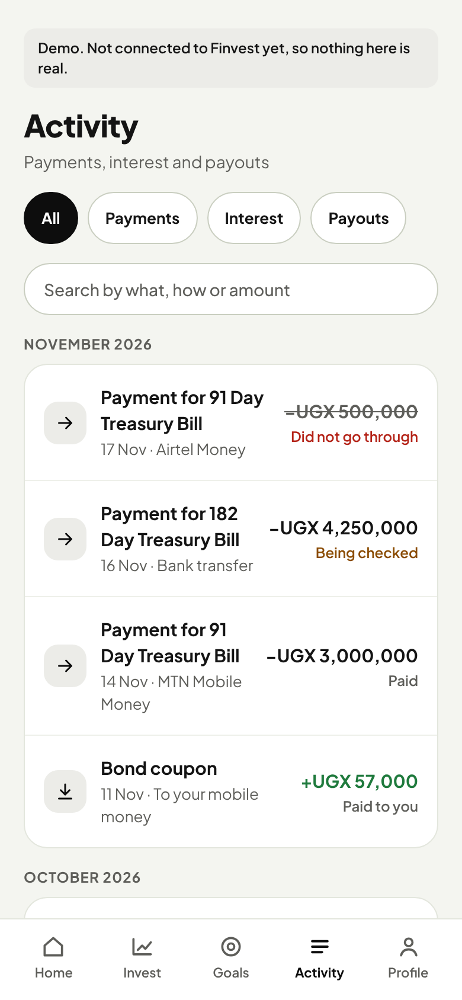
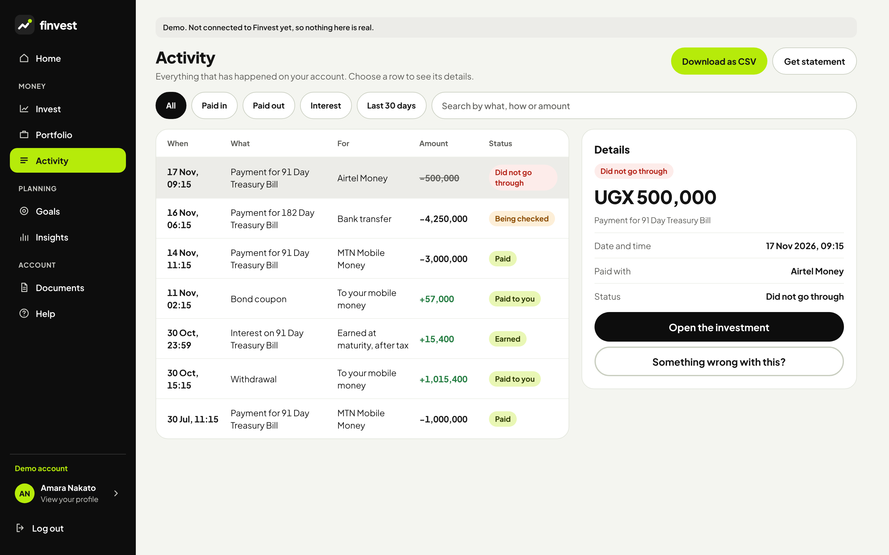

# Activity names bond money

Demo build (`EXPO_PUBLIC_DEMO_AUTH=1`), web. A paid bond coupon reads "Bond coupon", and a withdrawal "Withdrawal" (it was "Payout"). Money arriving with the client keeps its "+".

## Phone

## Wide

