# Bond holdings screenshots

From the demo build (`EXPO_PUBLIC_DEMO_AUTH=1`), one image per screen and layout.

## Portfolio with bonds (phone)

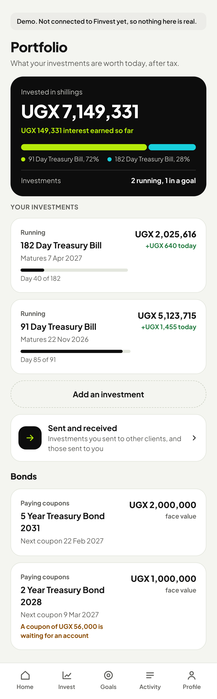

## Portfolio with bonds (wide)

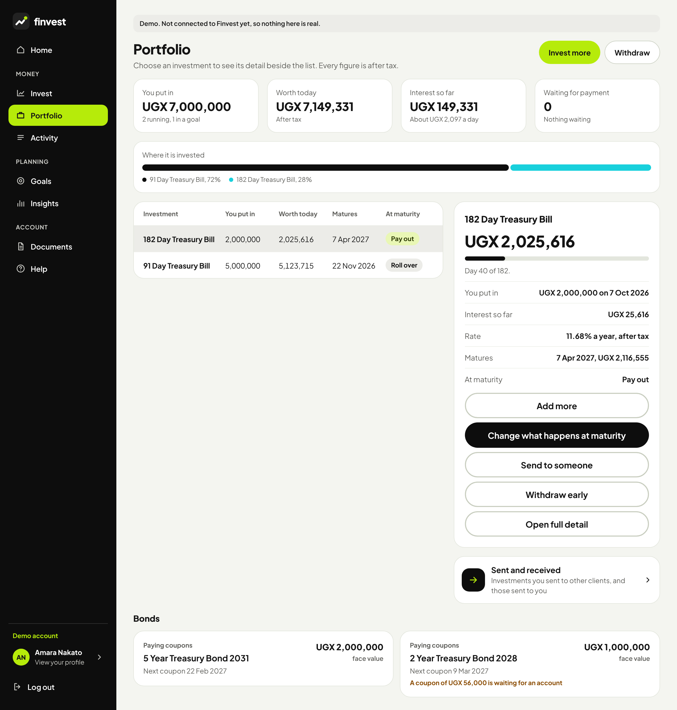

## Holding with a coupon waiting (phone)

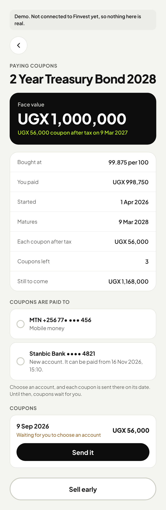

## Holding with a coupon waiting (wide)

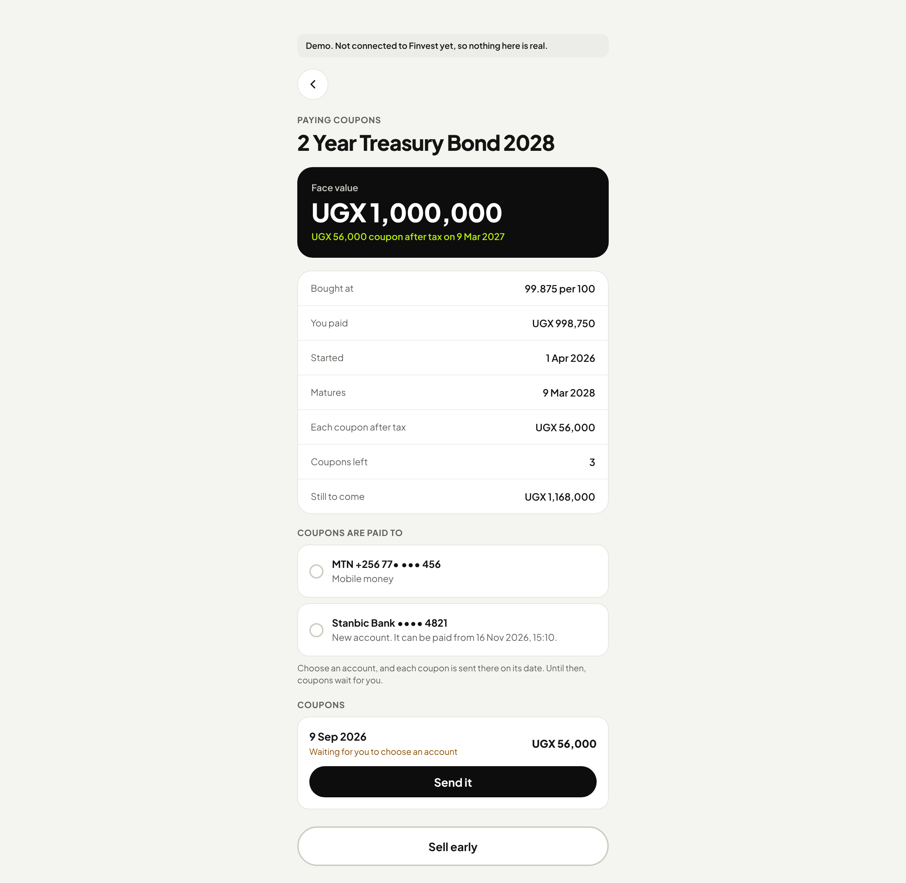

## Send a waiting coupon (phone)

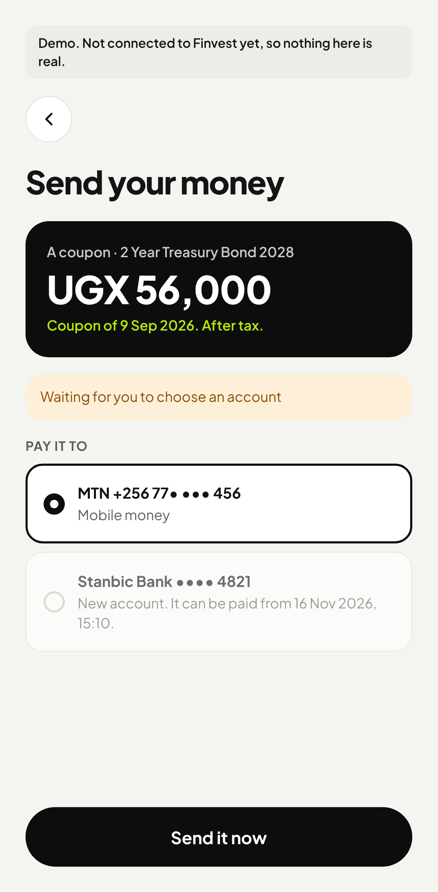

## Send a waiting coupon (wide)

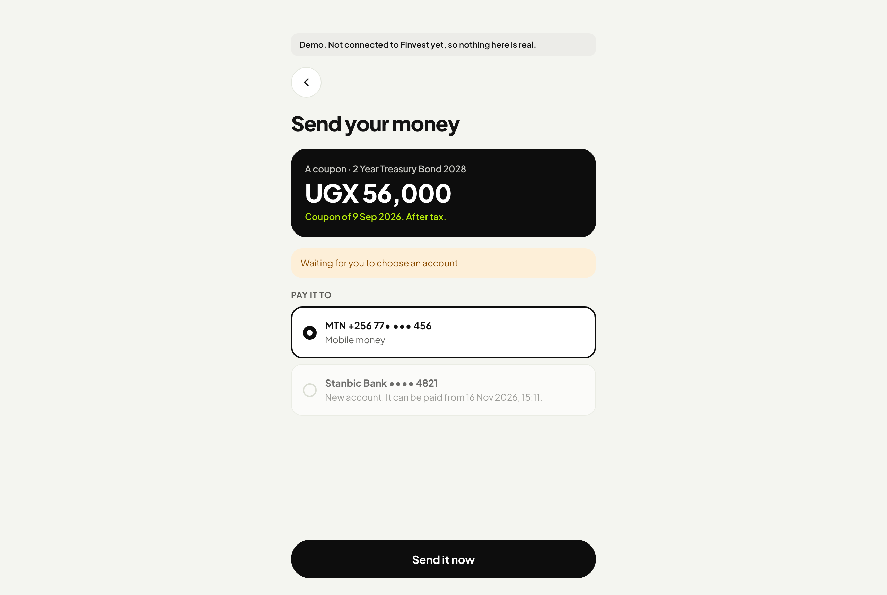

## Holding after the coupon is sent (phone)

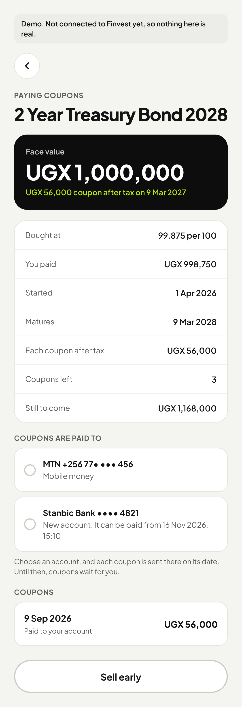

## Holding after the coupon is sent (wide)

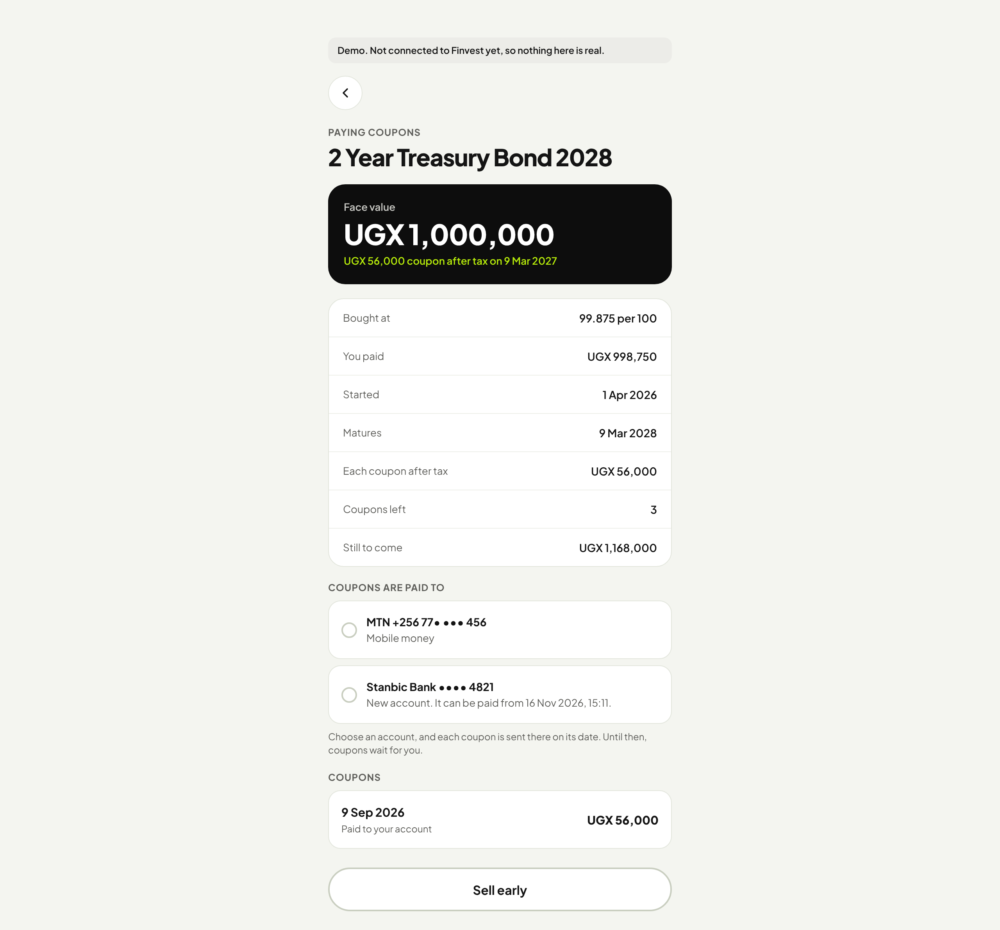

## Holding paying coupons to an account (phone)

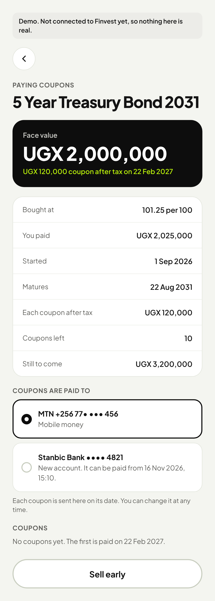

## Holding paying coupons to an account (wide)

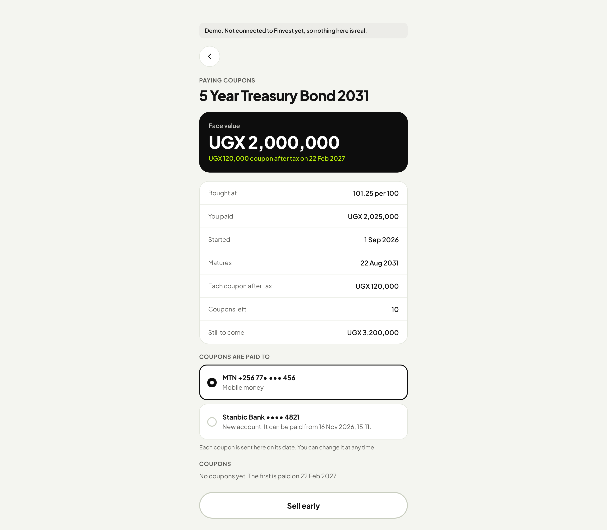

## Sell early (phone)

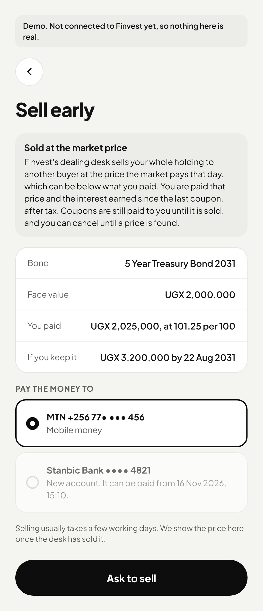

## Sell early (wide)

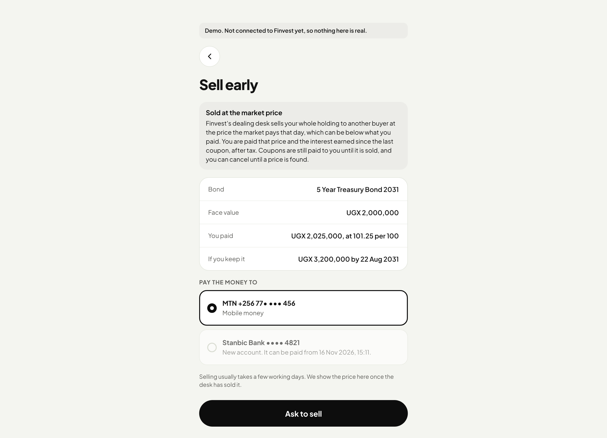

## Holding with a sale asked (phone)

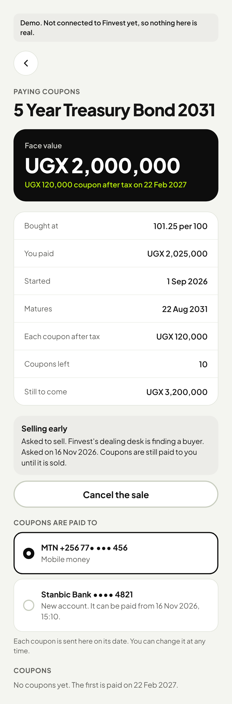

## Holding with a sale asked (wide)

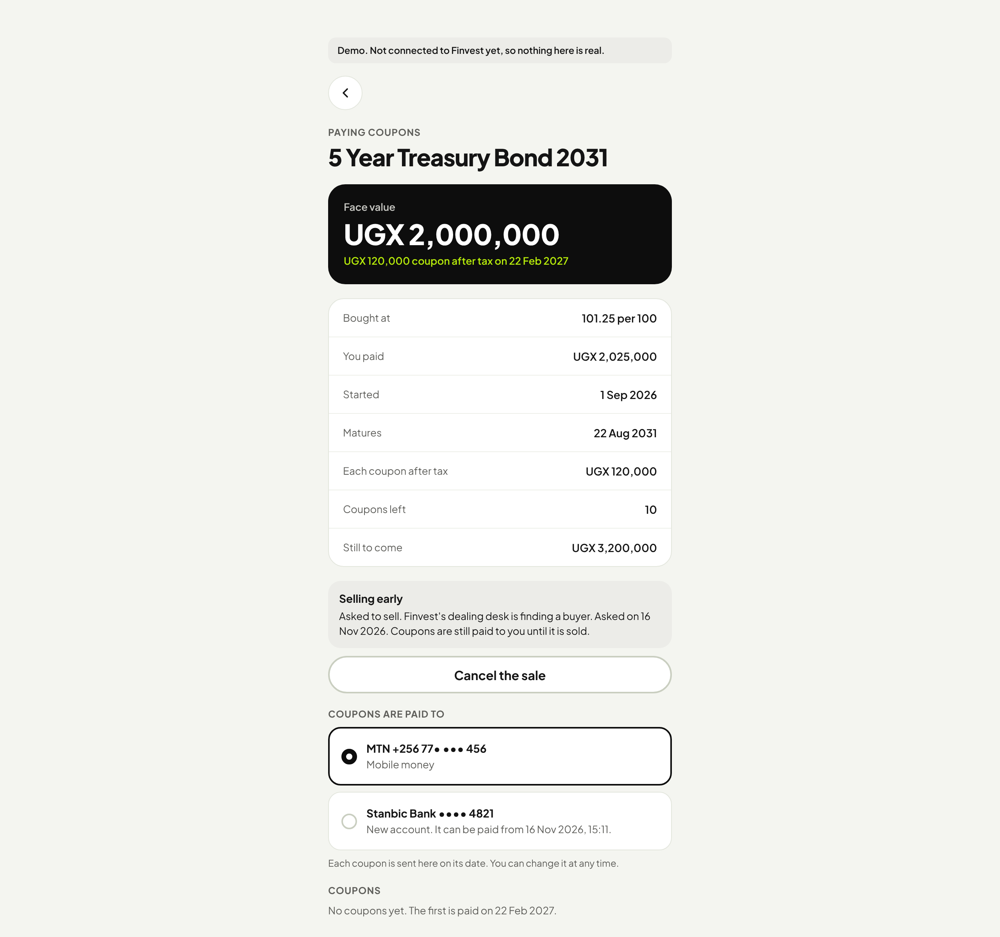

## Portfolio when bonds cannot be read (phone)

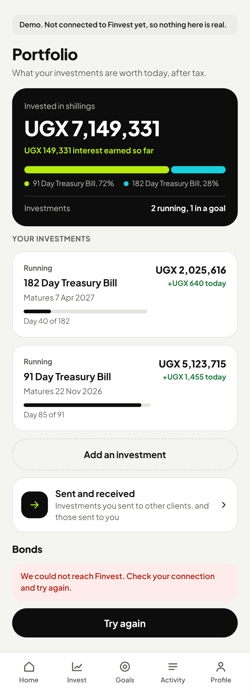

## Portfolio when bonds cannot be read (wide)

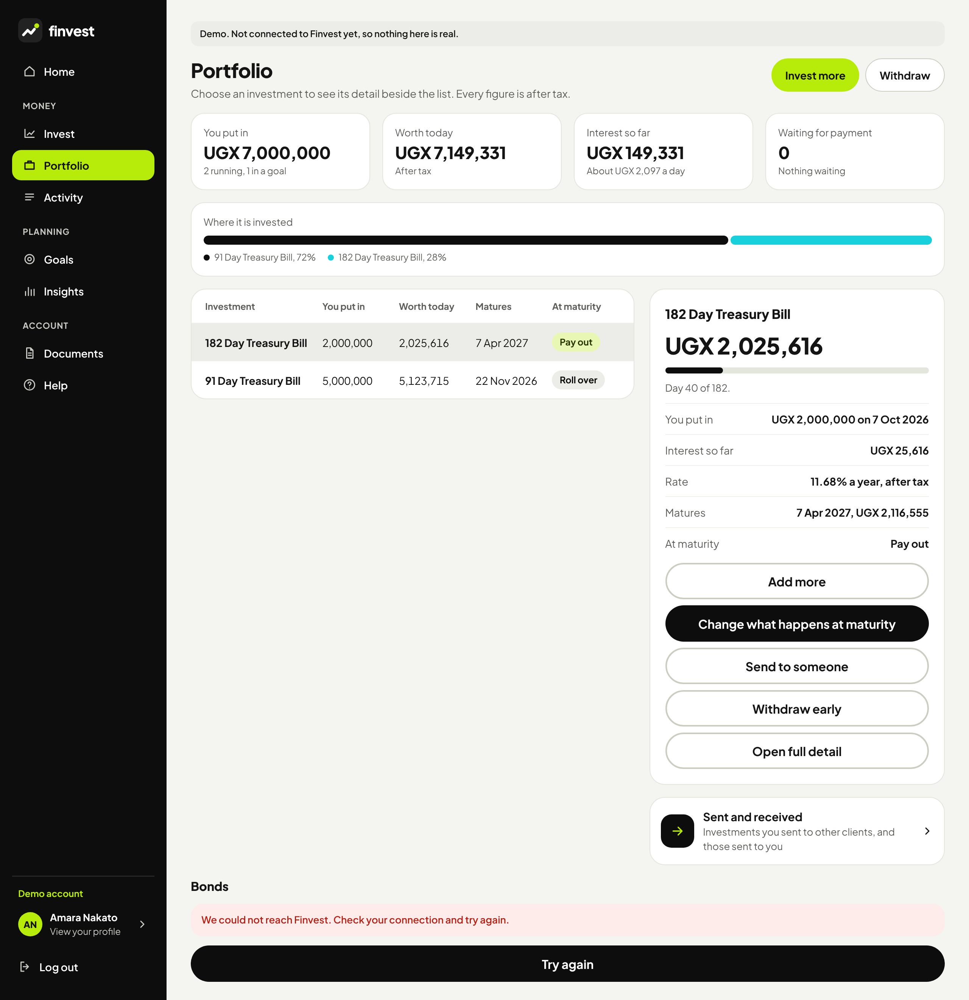
