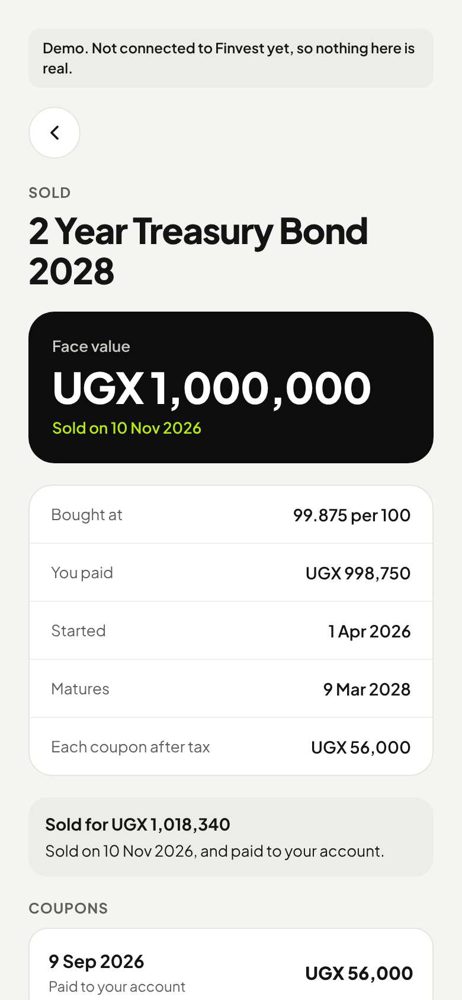
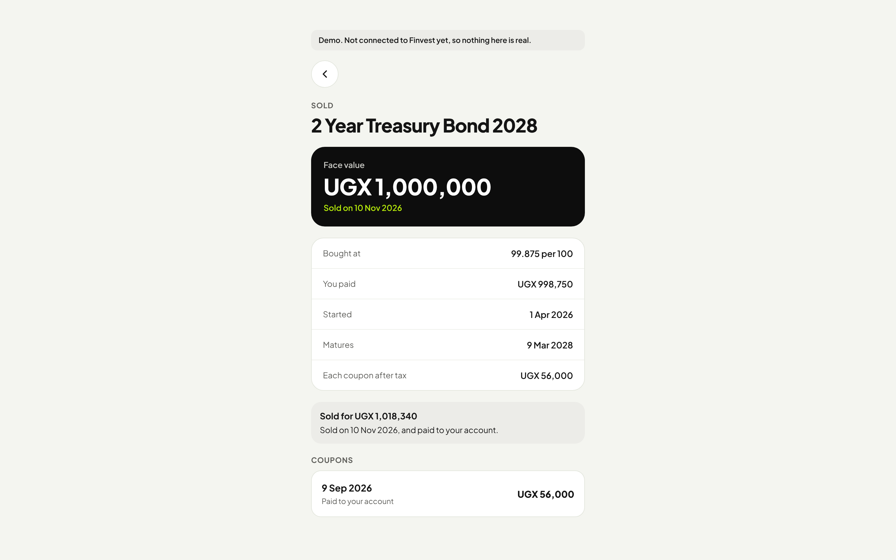
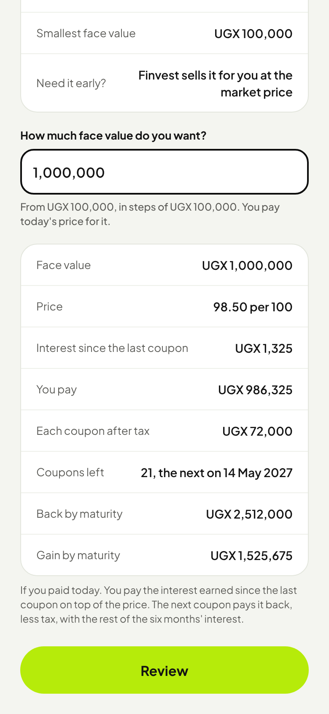
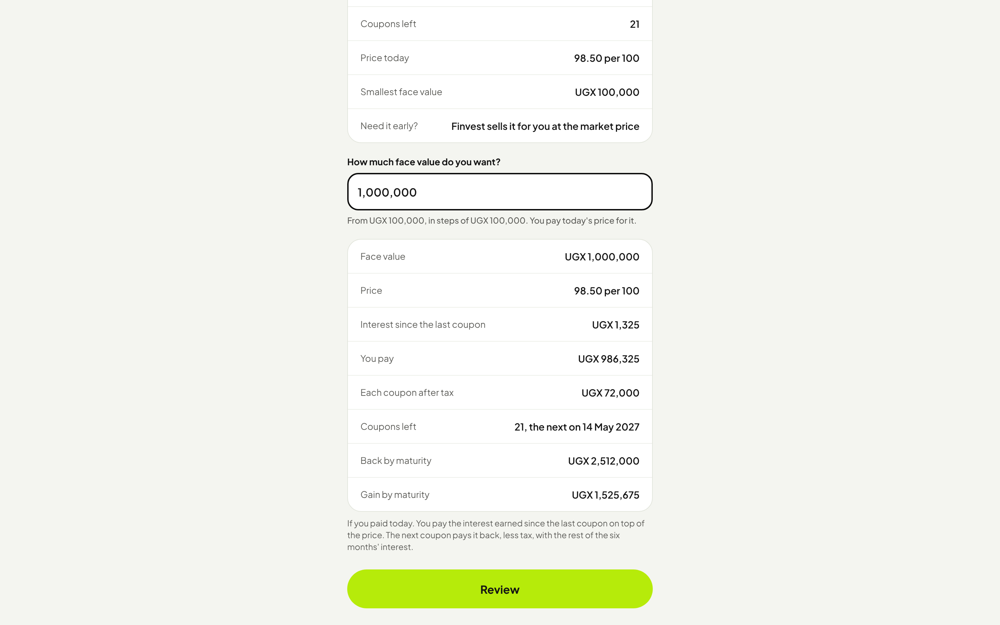

# Sold bonds and the accrued interest note

Demo build (`EXPO_PUBLIC_DEMO_AUTH=1`), web.

## A sold holding, phone (`?sample=sold`)
No "Coupons left" or "Still to come" rows; the card reads "Sold on 10 Nov 2026".

## A sold holding, wide

## Bond quote note, phone
"The next coupon pays it back, less tax, with the rest of the six months' interest."

## Bond quote note, wide

