# Statements in Excel as well as PDF

Documents in the client app, demo build, phone (390 wide) and wide (1280 wide).

## Phone

### The form, PDF chosen (default)
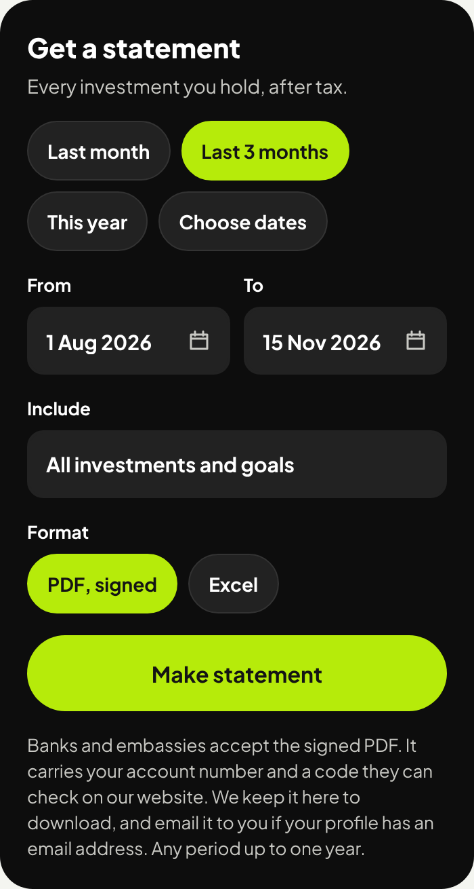

### The form, Excel chosen
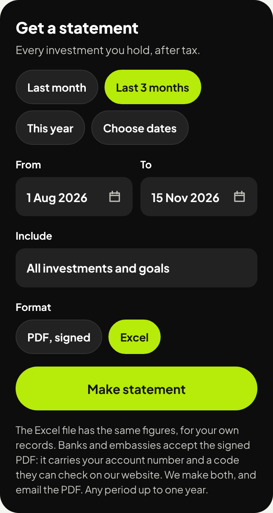

### Ready, Excel offered first, the signed PDF beside it
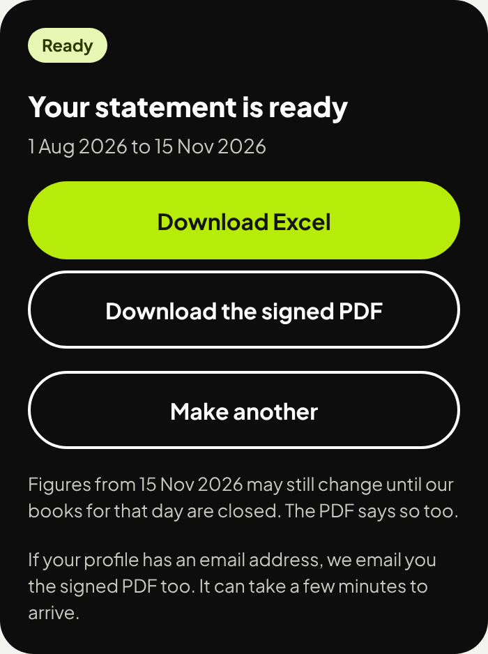

### The list: Excel beside each statement that has one (the oldest month has only the PDF)
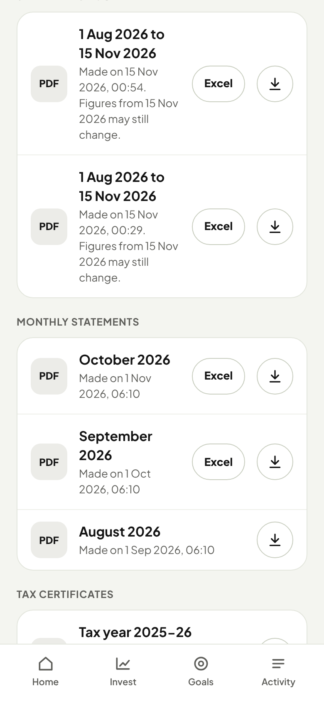

## Wide

### The form, PDF chosen (default)
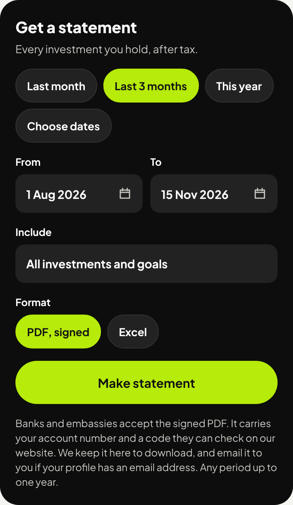

### The form, Excel chosen
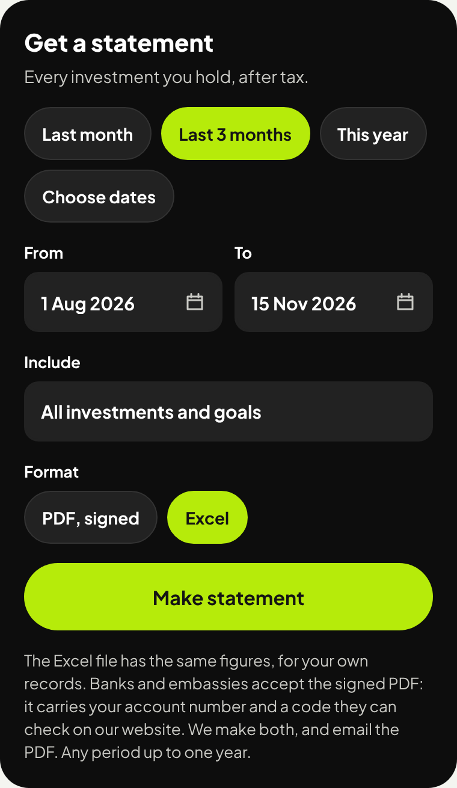

### Ready, Excel offered first
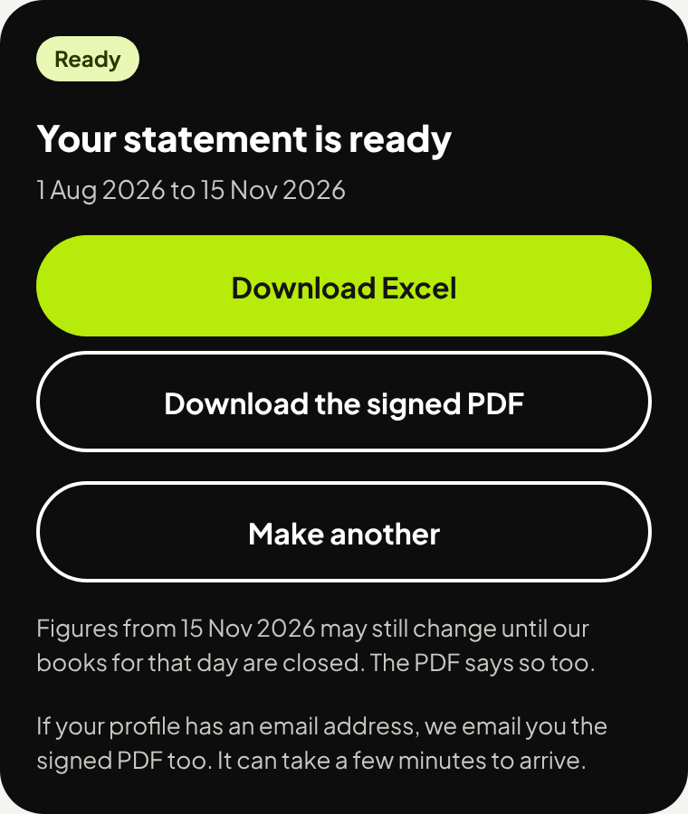

### The whole page with the list
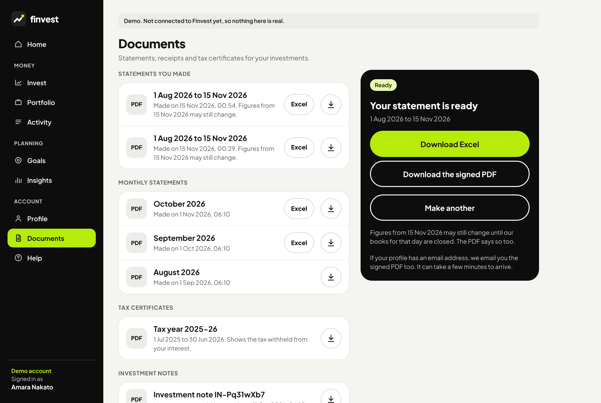

## The workbook

A sample statement's workbook, opened in LibreOffice and printed with grid lines.

### Summary
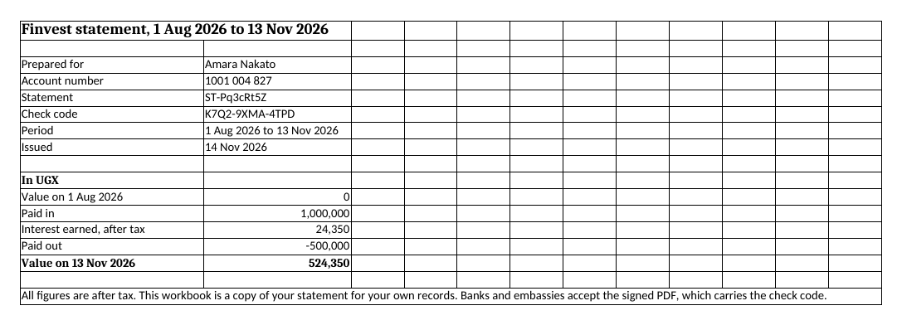

### Your investments
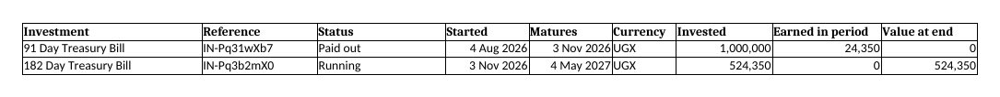

### What happened
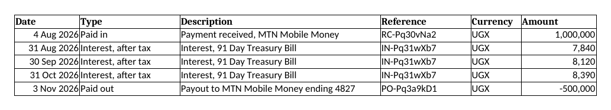
