# Company and group accounts from sign-up

Demo build (EXPO_PUBLIC_DEMO_AUTH=1), headless Chromium. Phone 390x844, wide 1440x900, both at 2x.

## Create your account, with the company link, phone

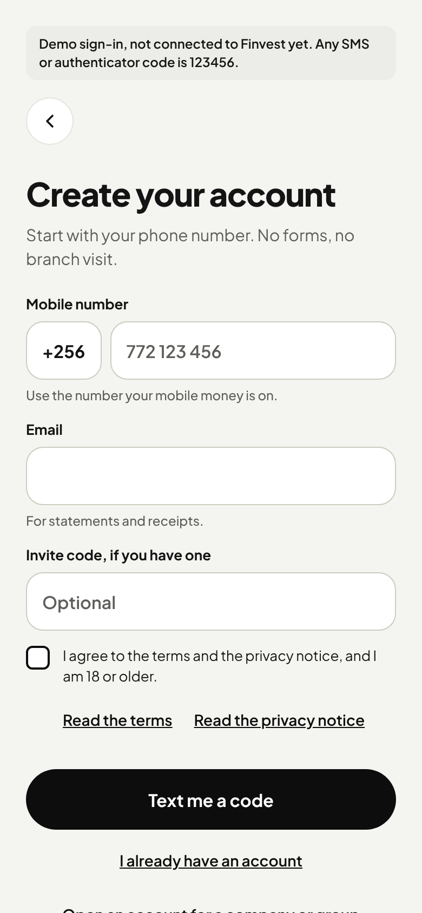

## Create your account, with the company link, wide

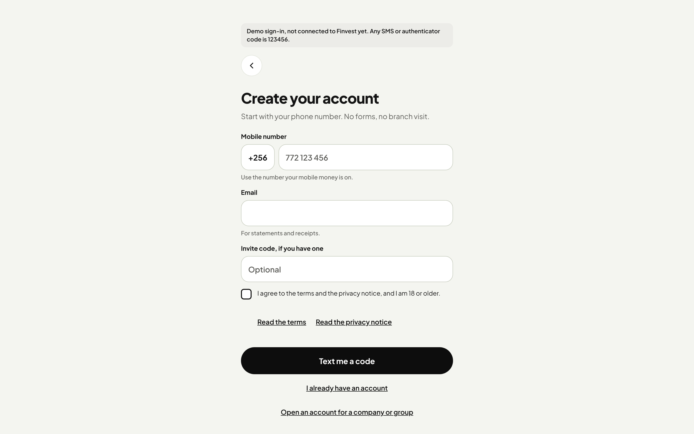

## It starts with your own account (new), phone

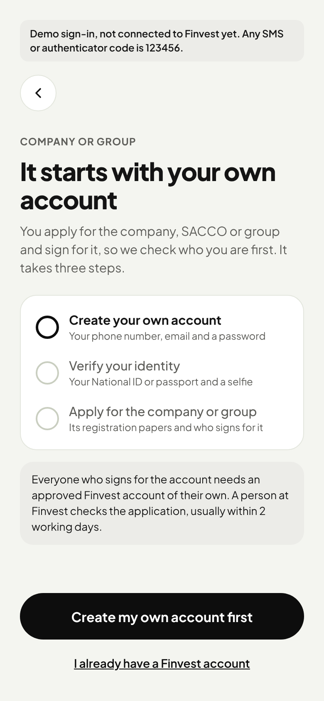

## It starts with your own account (new), wide

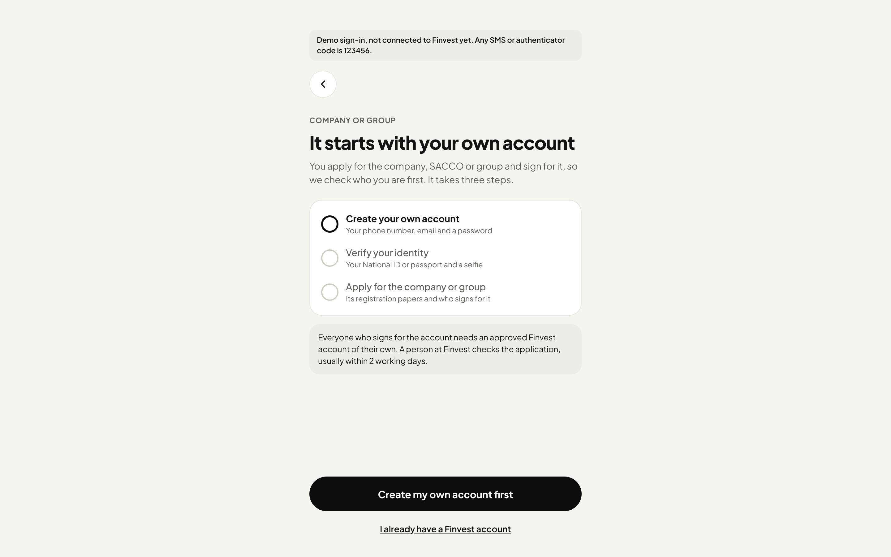

## Create your account, step 1 of 3, phone

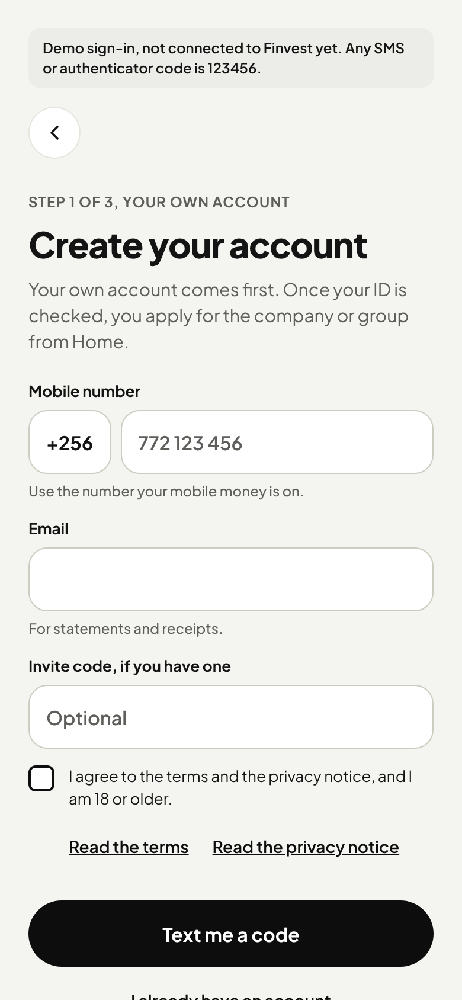

## Create your account, step 1 of 3, wide

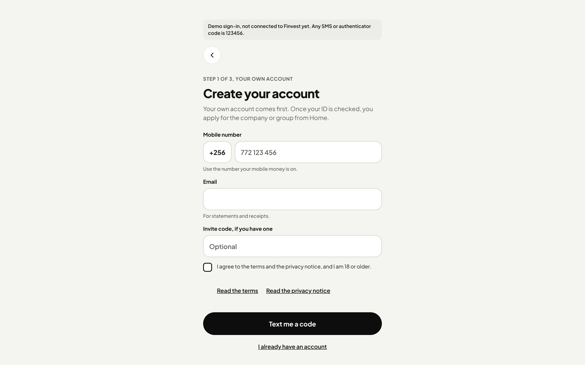

## Create your account, step 1 of 3, nothing filled in (error), phone

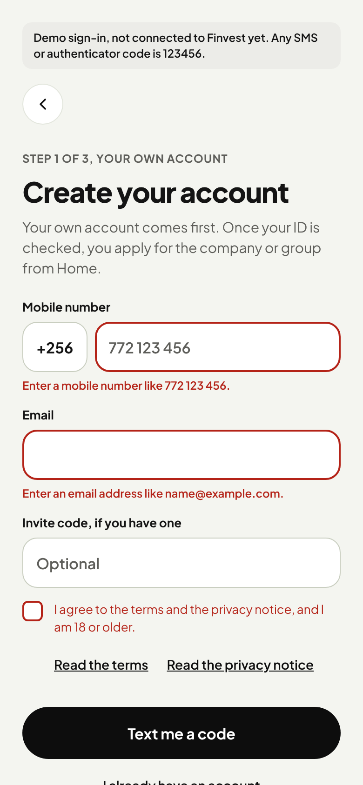

## Create your account, step 1 of 3, nothing filled in (error), wide

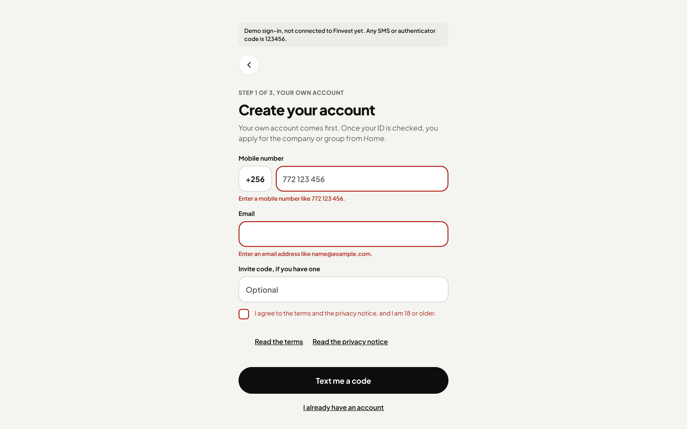

## Home, Get set up with the company step, ID not yet approved, phone

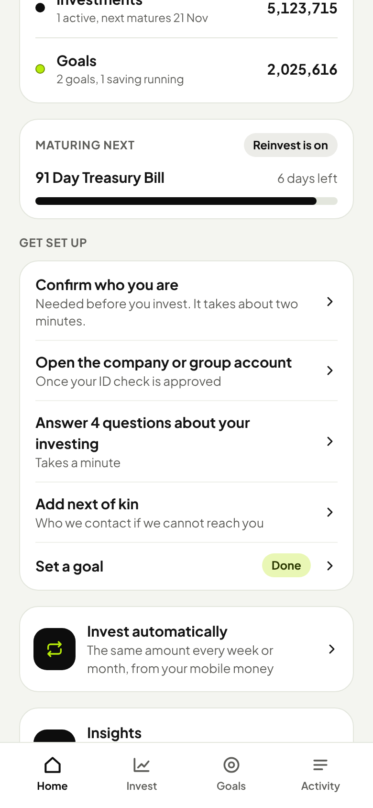

## Home, Get set up with the company step, ID not yet approved, wide

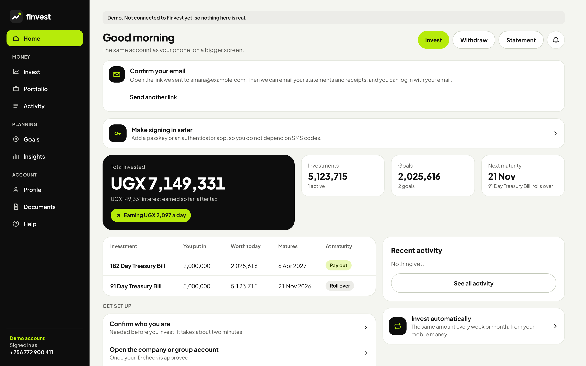

## What kind of account?, ID check not approved yet, phone

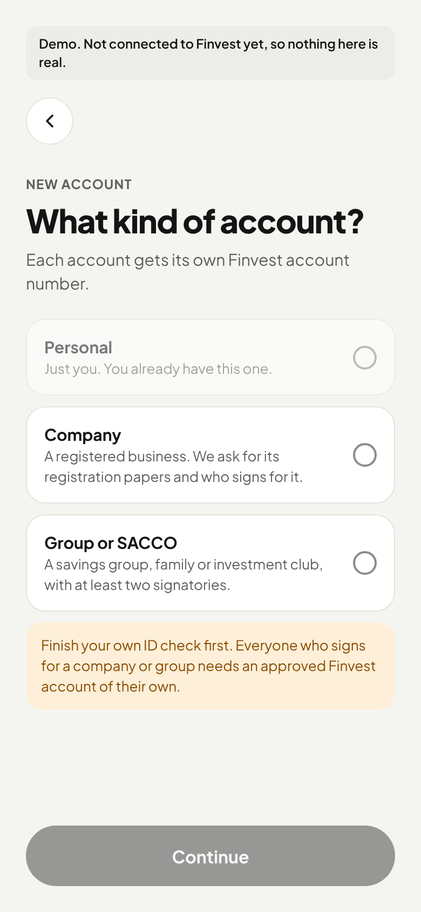

## What kind of account?, ID check not approved yet, wide

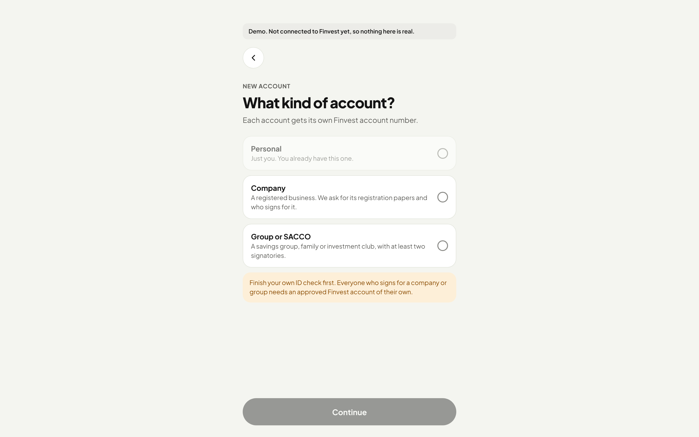

## What kind of account?, after I already have a Finvest account and logging in, phone

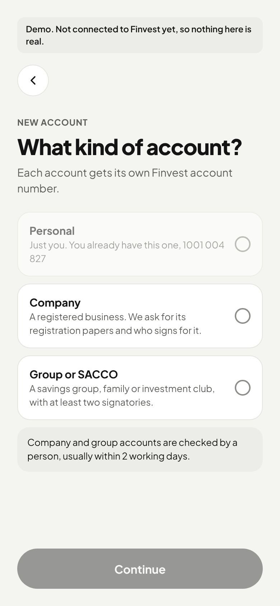

## What kind of account?, after I already have a Finvest account and logging in, wide

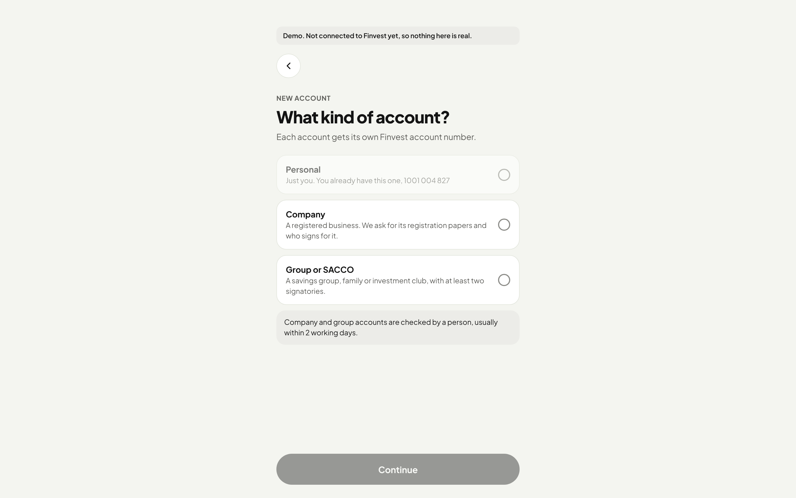
