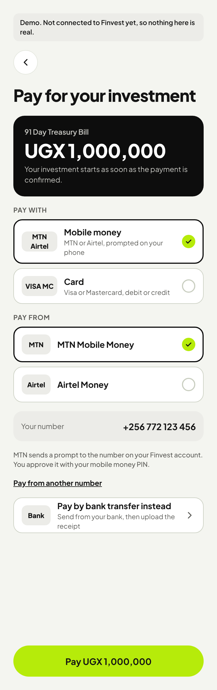
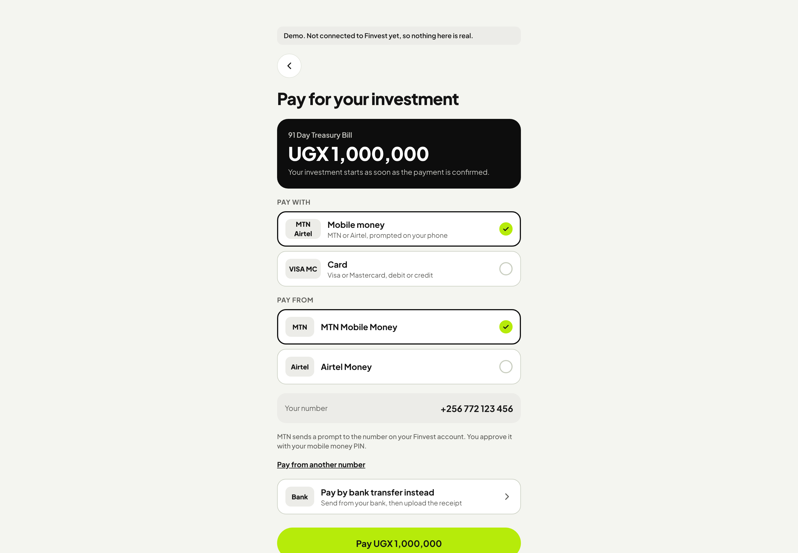
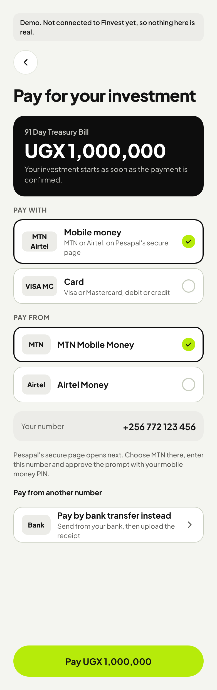
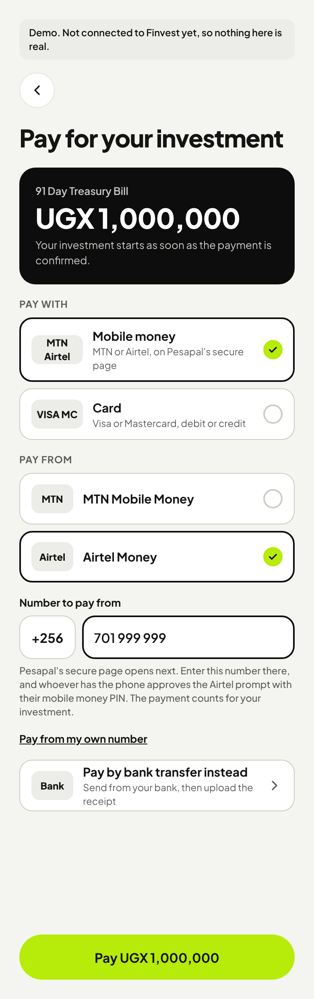
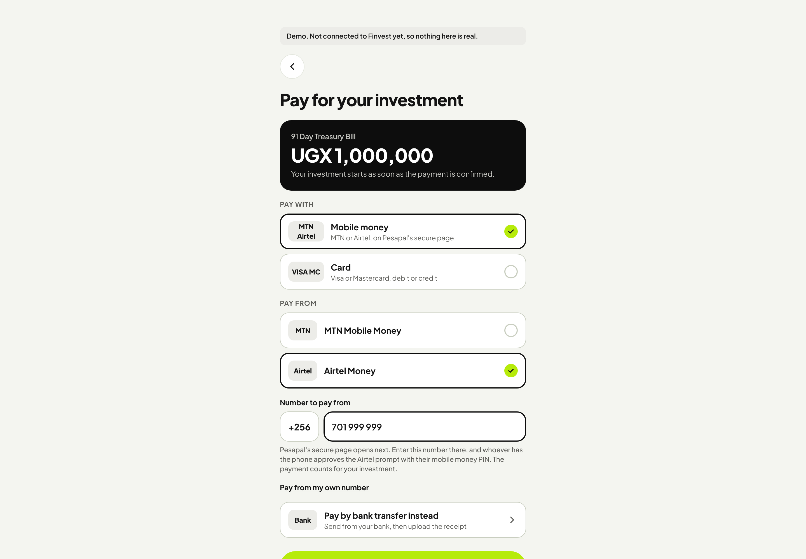

# Mobile money wording on the pay screen

When Settings choose Pesapal to collect mobile money, the pay screen no longer says the network sends a prompt to the number. Pesapal's own page asks for the network and number, so the screen says that page opens next. With ioTec collecting, the wording is unchanged.

## ioTec collects: the network prompts the client's own number (unchanged)

Phone

Wide

## Pesapal collects: the client's own number

Phone

Wide

## Pesapal collects: another number

Phone

Wide

