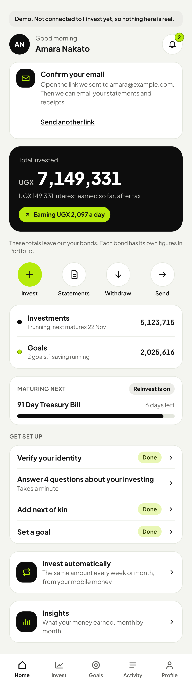
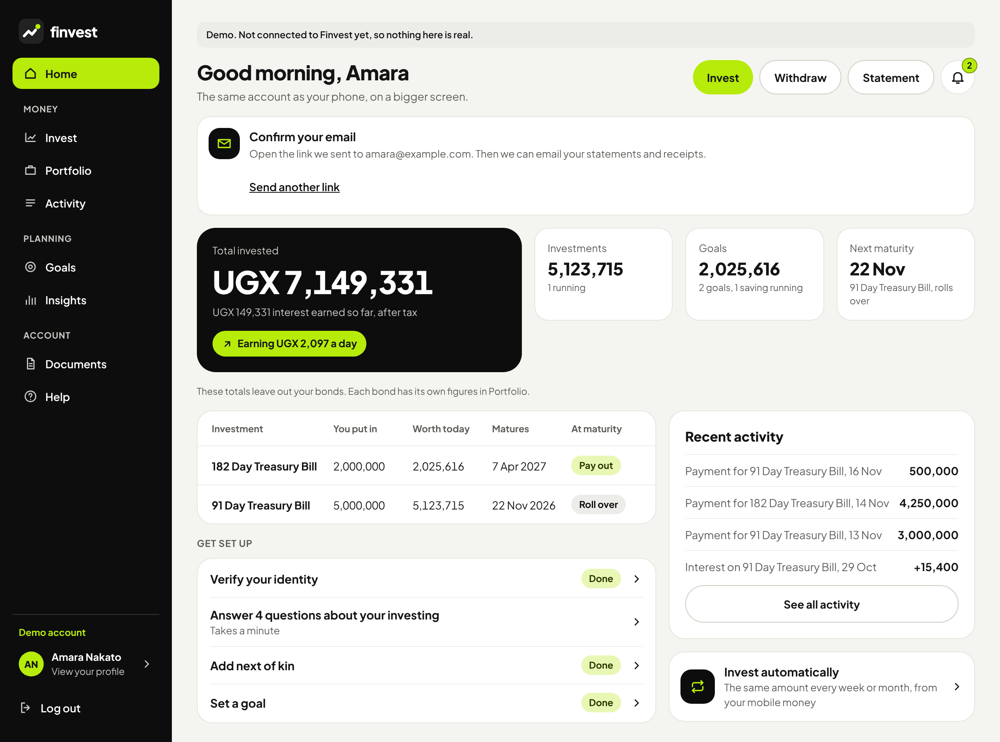
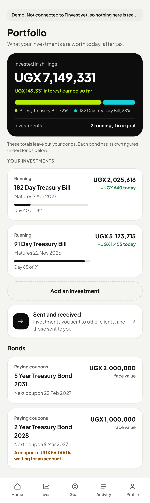
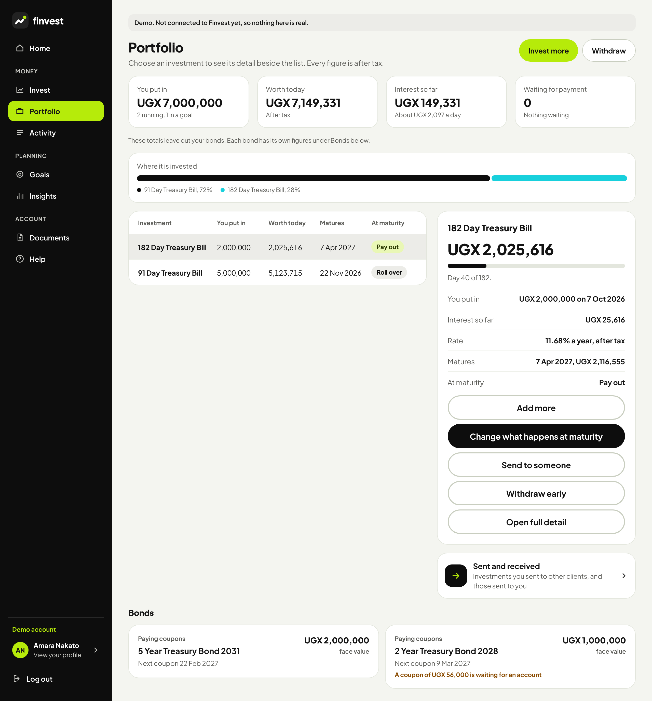
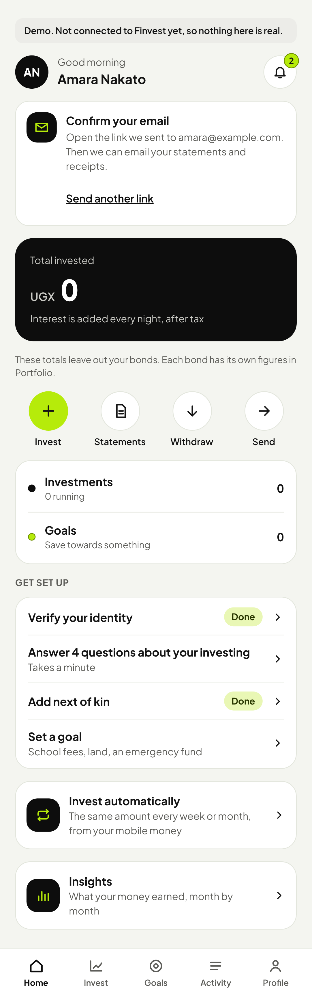
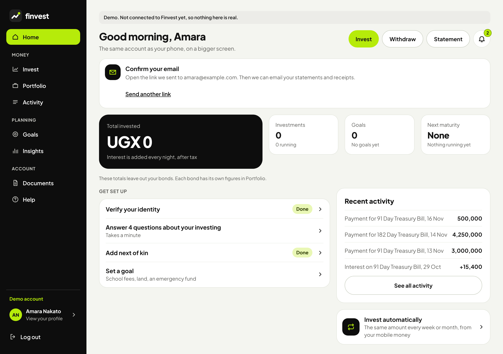
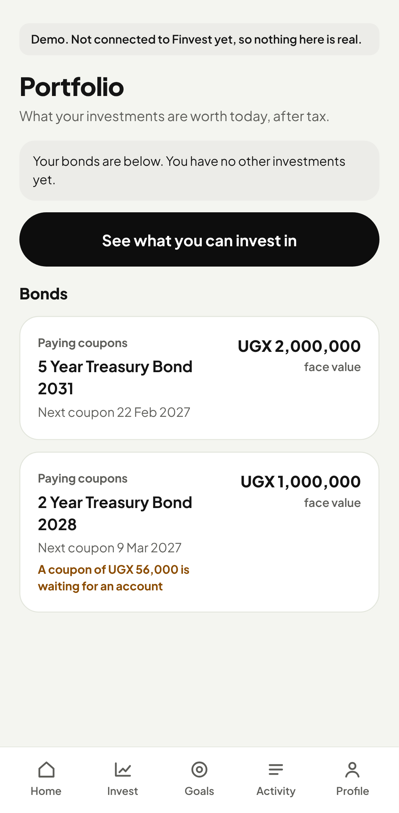
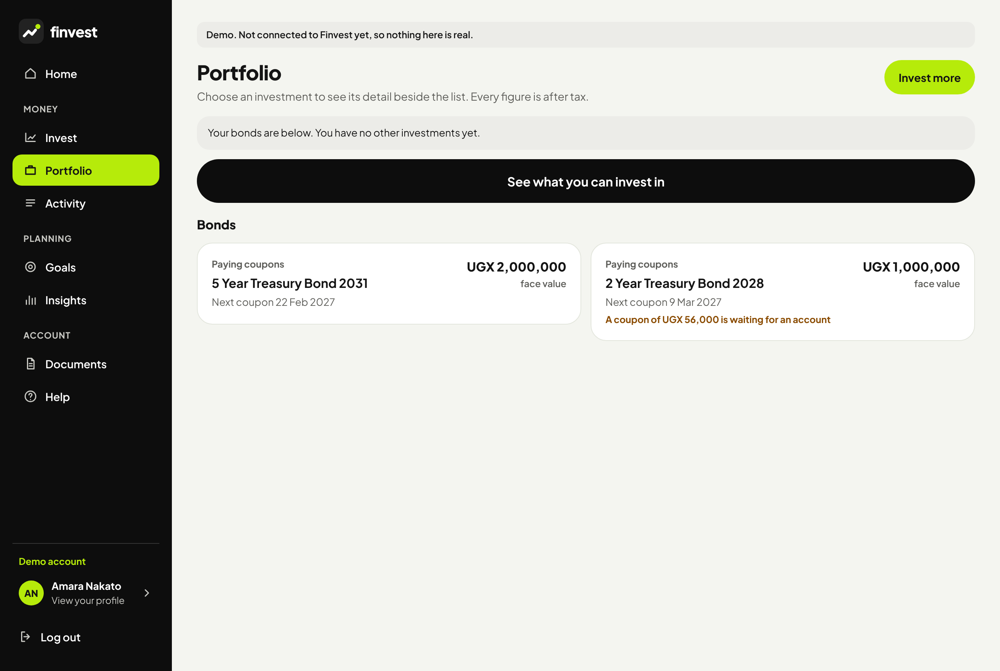

# Totals beside bonds: screenshots

From the demo build (`EXPO_PUBLIC_DEMO_AUTH=1`; bonds only is `/?investments=none`), one image per screen and layout.

## Home, with investments and bonds (phone)

## Home, with investments and bonds (wide)

## Portfolio, with investments and bonds (phone)

## Portfolio, with investments and bonds (wide)

## Home, with bonds only (phone)

## Home, with bonds only (wide)

## Portfolio, with bonds only (phone)

## Portfolio, with bonds only (wide)

