# Regula liveness screenshots

From the demo web build. The demo has no Regula service, so a stand-in shows where Regula's own camera screen opens (docs/identity-checks.md#regula-liveness).

## Take a live selfie (phone)

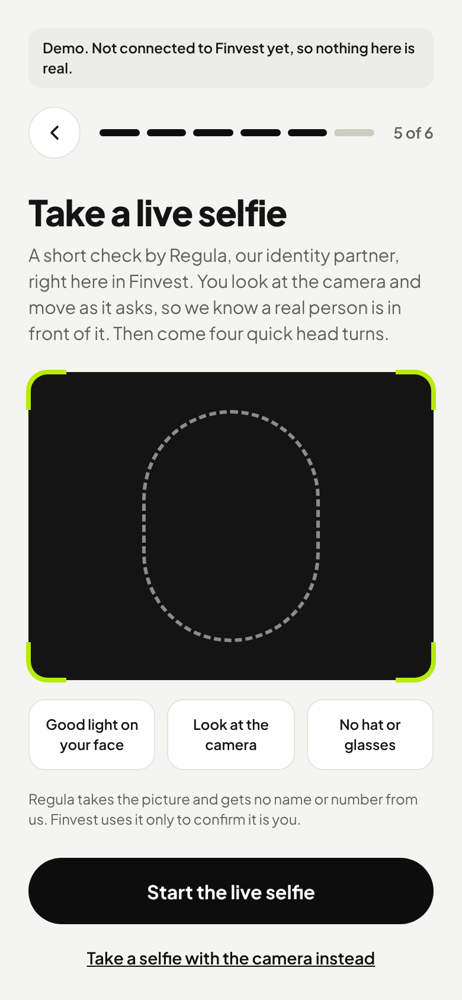

## Regula's session running (demo stand-in) (phone)

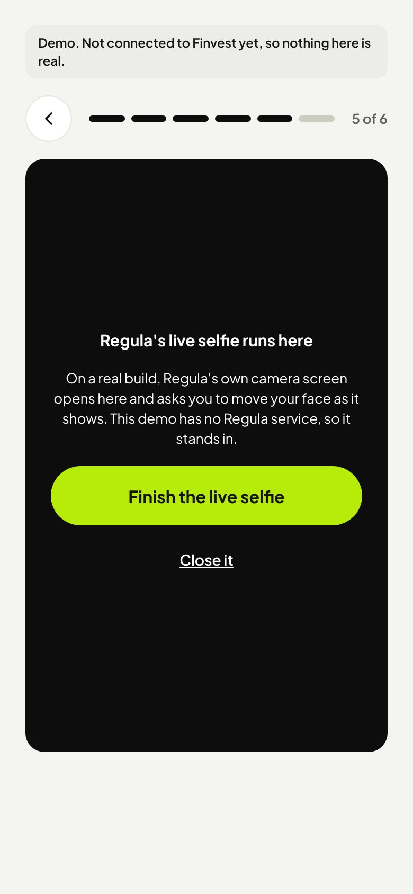

## Session closed: open it again (phone)

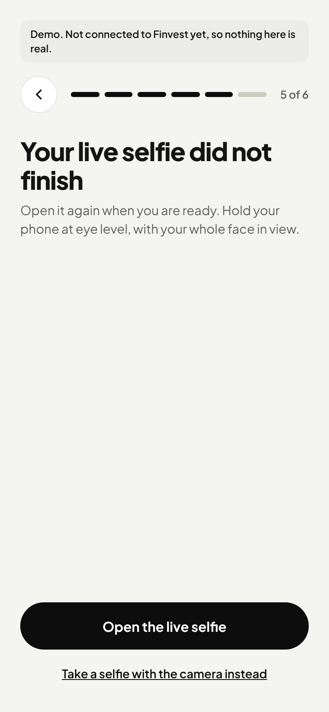

## Checking the live selfie (phone)

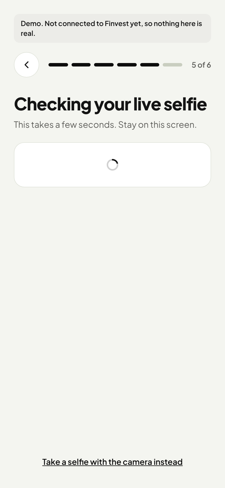

## Live selfie done (phone)

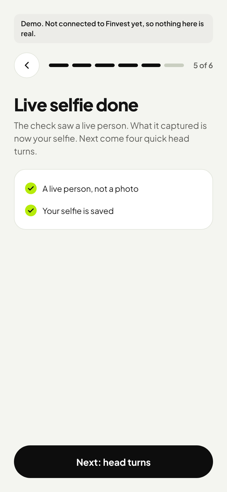

## Then the head turns (phone)

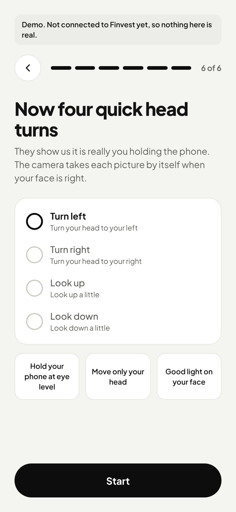

## Not a live person: try again (phone)

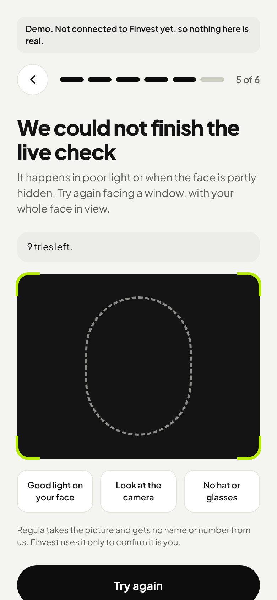

## Take a live selfie (wide)

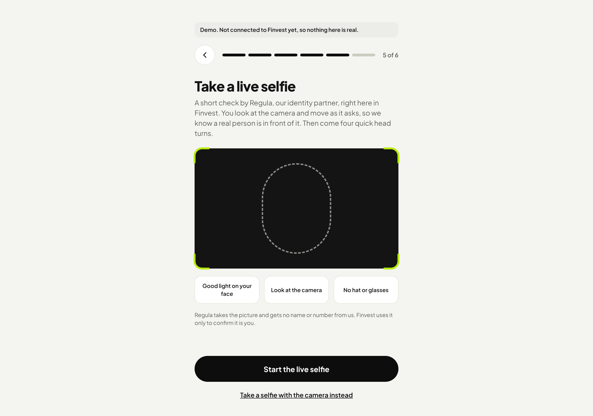

## Regula's session running (demo stand-in) (wide)

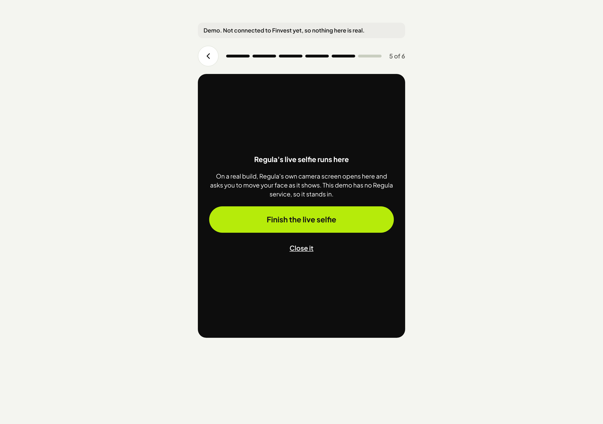

## Session closed: open it again (wide)

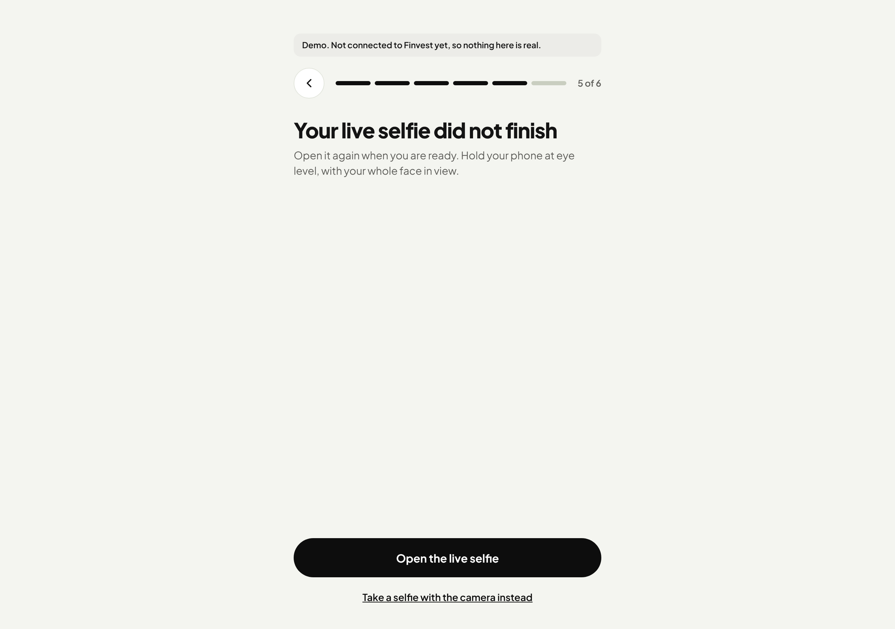

## Checking the live selfie (wide)

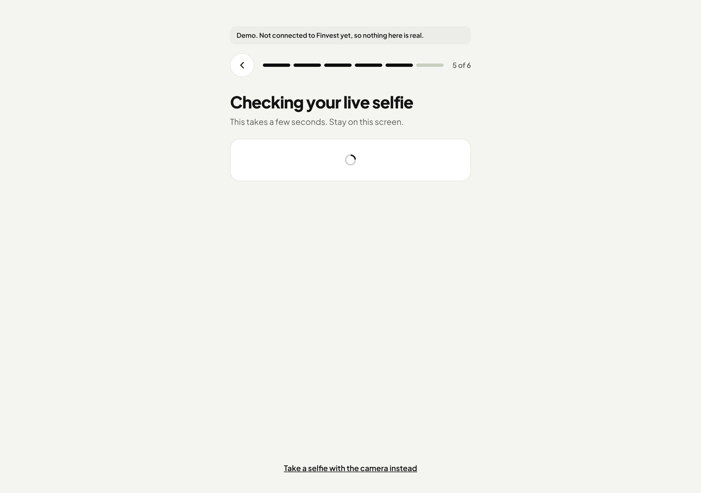

## Live selfie done (wide)

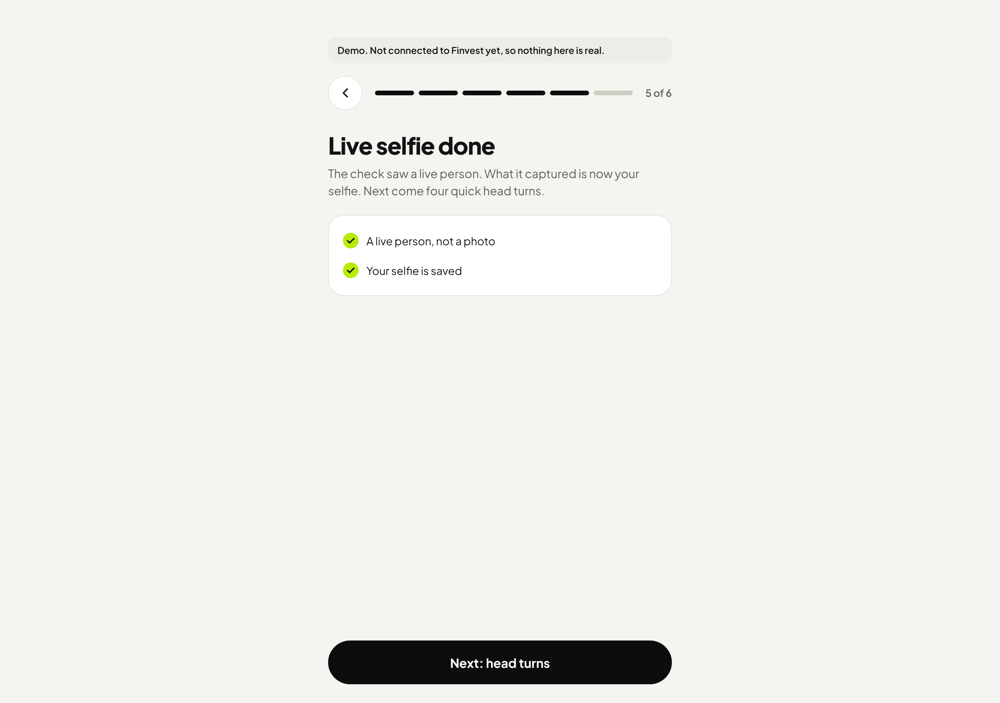

## Then the head turns (wide)

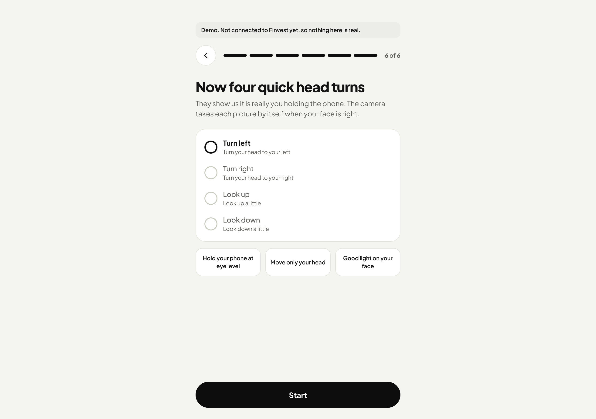

## Not a live person: try again (wide)

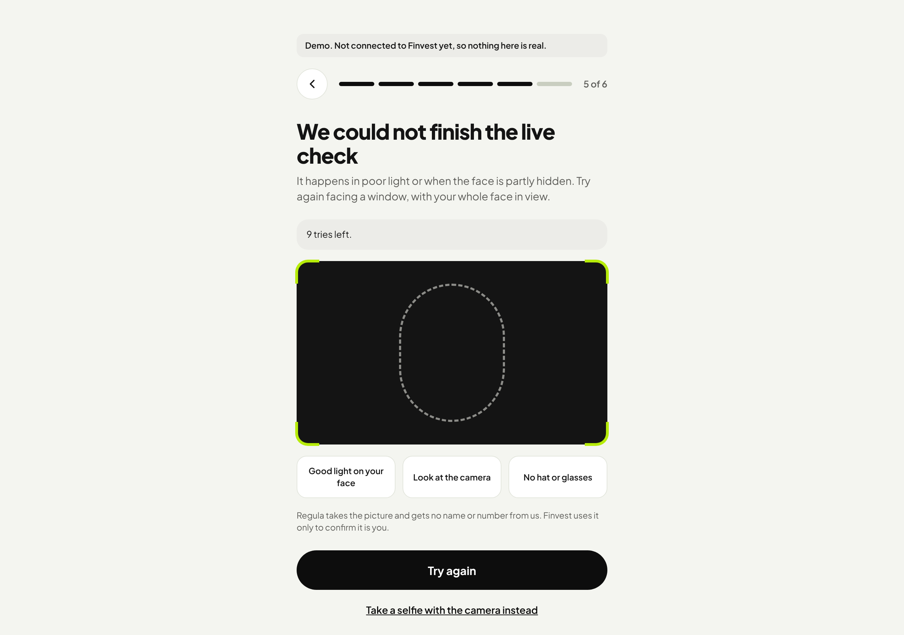
