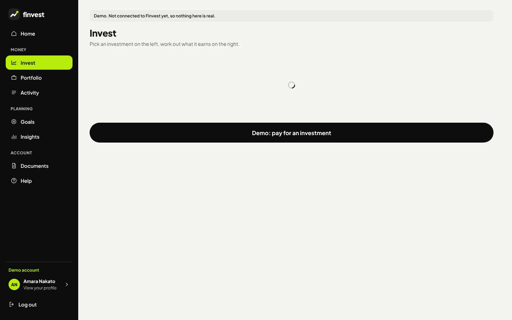

# Screen changes: the first frame after tapping Invest

Taken from the browser's own frame stream (Chrome's screencast) on the demo web build, about 4 seconds after signing in, at phone size (Pixel 7) and wide (1440 x 900). Each picture is the first frame drawn after the tap.

## Phone, before: blank for about 0.3 s

## Phone, after: the Invest screen at once

## Wide, before: blank for about 0.3 s

## Wide, after: the Invest screen at once

