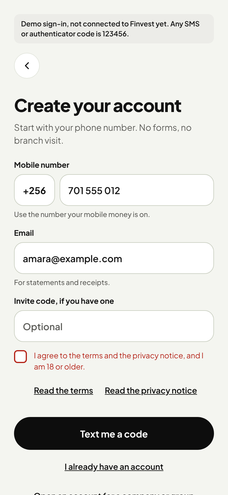
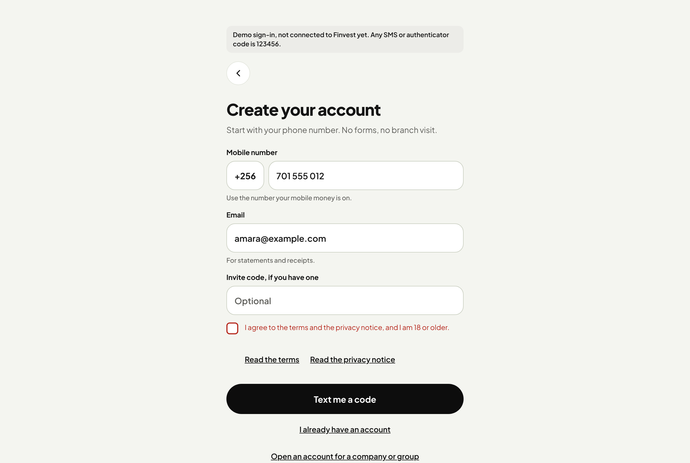
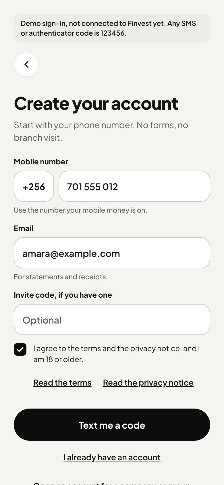
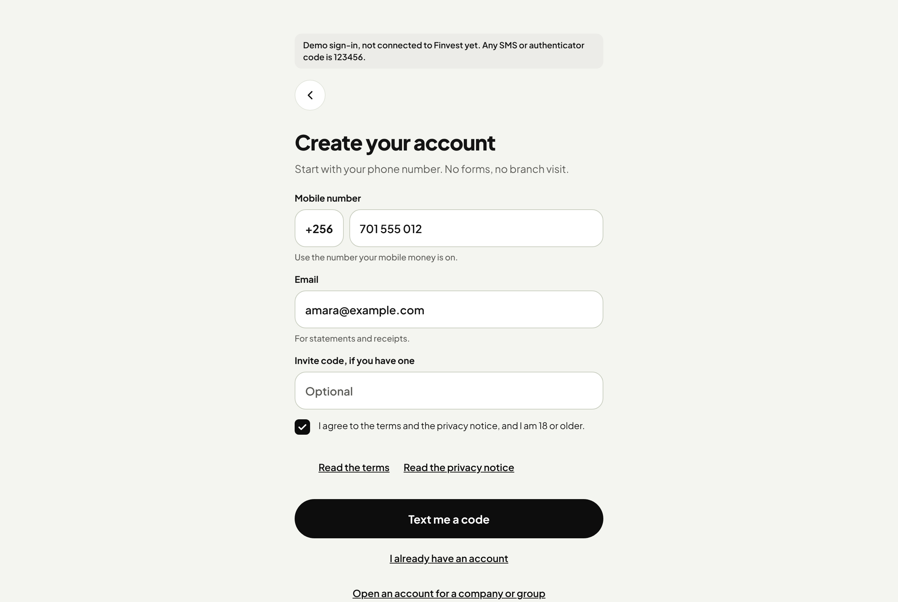
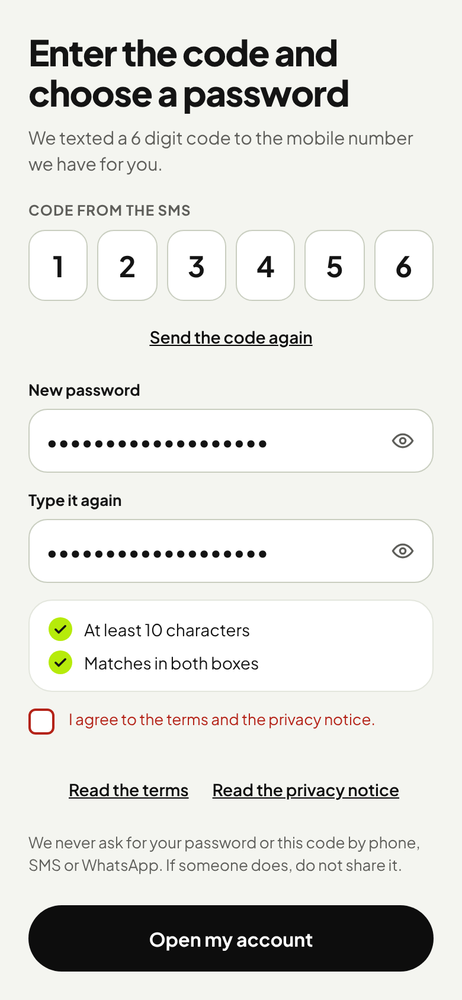
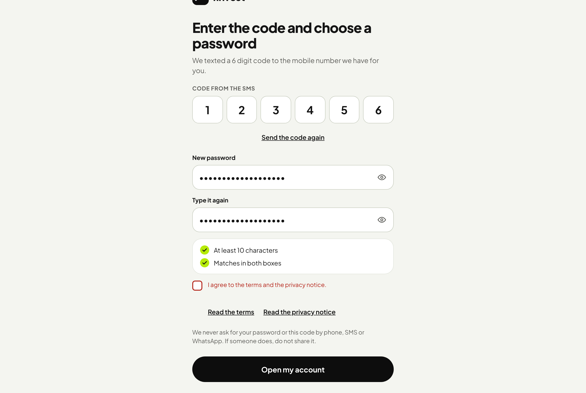
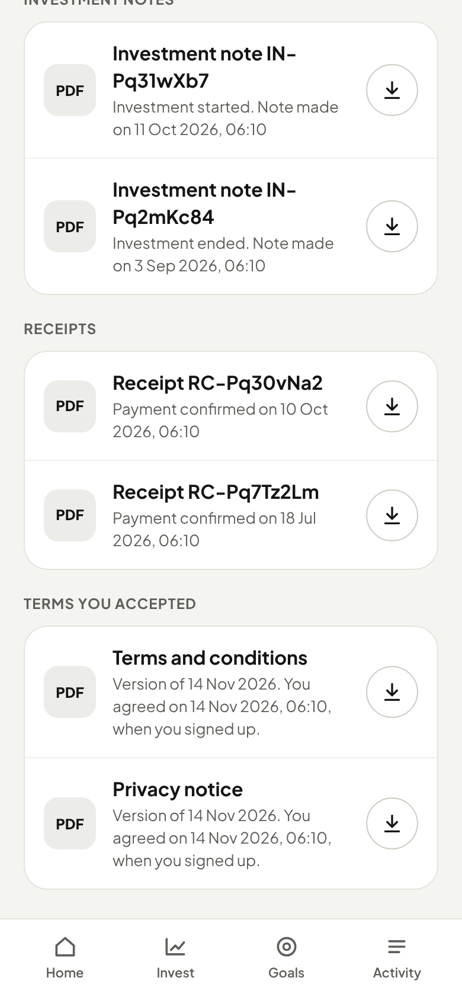
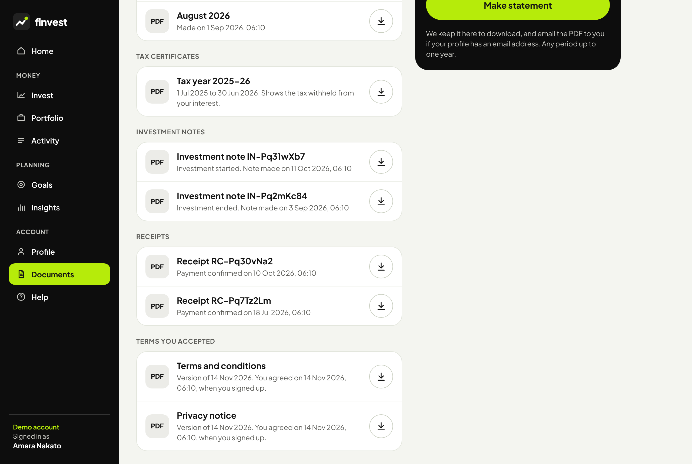

# Terms acceptance screenshots

From the demo web build (`EXPO_PUBLIC_DEMO_AUTH=1`). See docs/documents.md, "Terms you accepted".

## Sign-up, terms not ticked (phone)

## Sign-up, terms not ticked (wide)

## Sign-up, terms ticked (phone)

## Sign-up, terms ticked (wide)

## Claim, refused until the terms are ticked (phone)

## Claim, refused until the terms are ticked (wide)

## Documents, Terms you accepted (phone)

## Documents, Terms you accepted (wide)

