# Coupons on the desk's bonds

Console stub, signed in as Finance. `?sample=empty` and `?sample=offline` show the empty and error states.

## Wide

### Coupons due and recorded (wide)

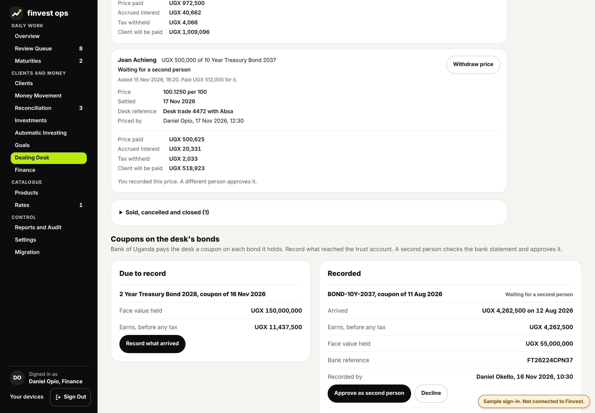

### Record a coupon (wide)

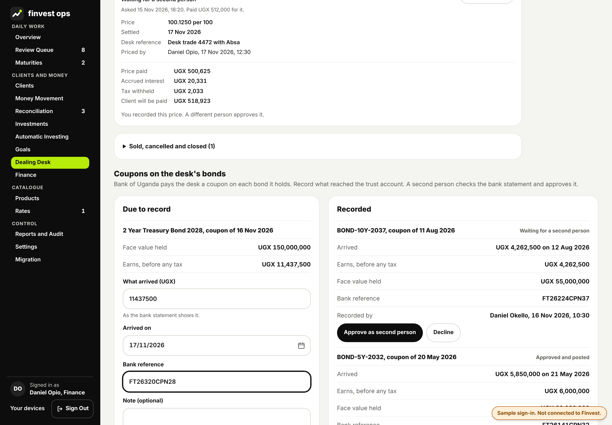

### Record a coupon that differs (needs a note) (wide)

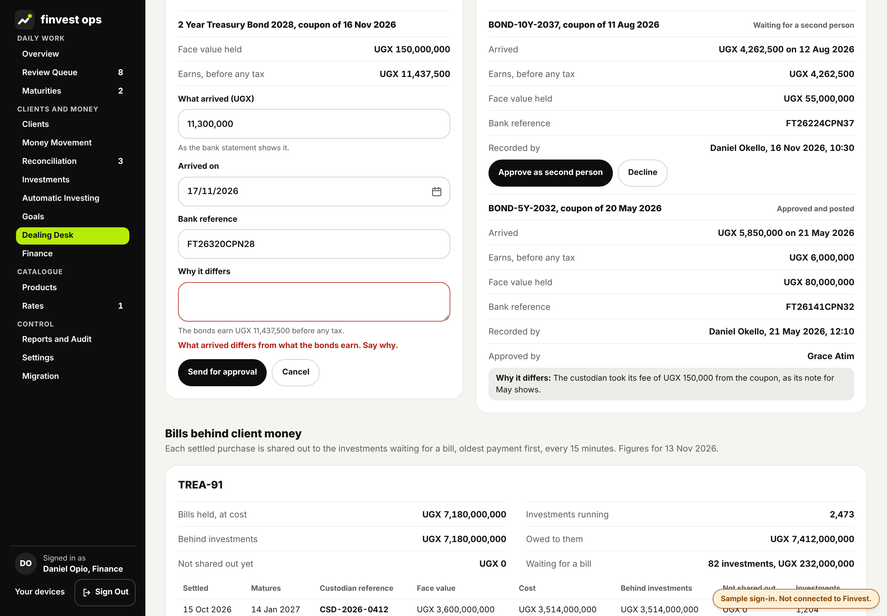

### Approve a coupon (bank statement question) (wide)

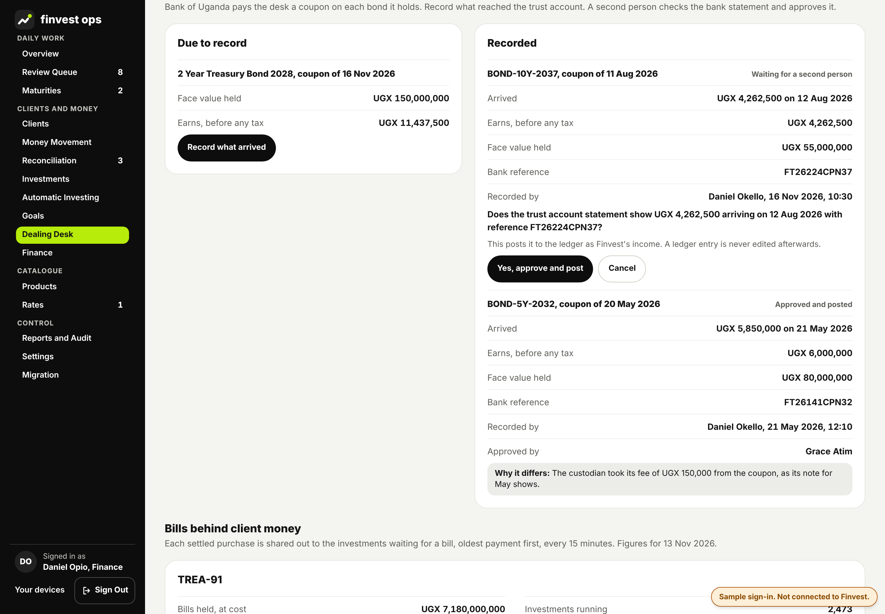

### Coupon approved and posted (wide)

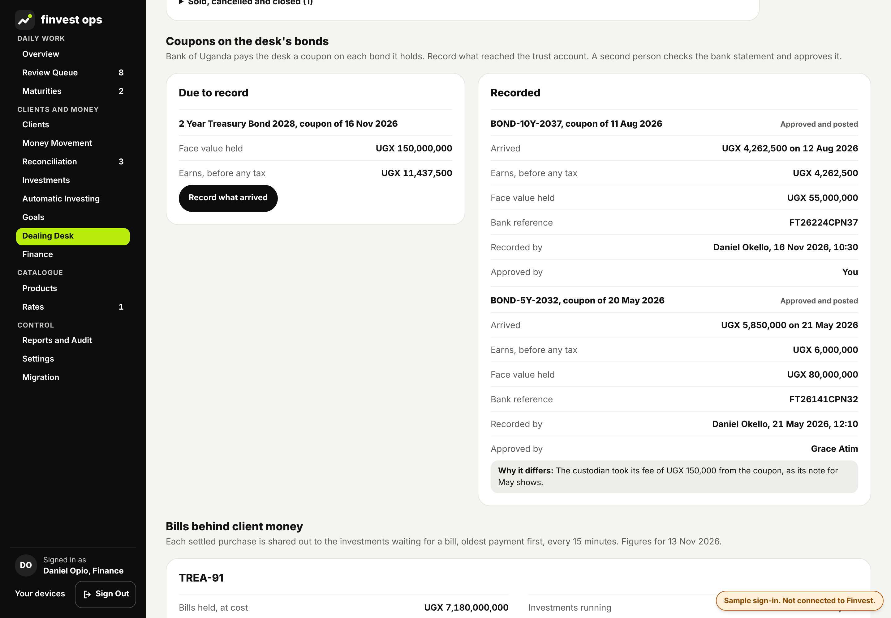

### Nothing due or recorded (empty) (wide)

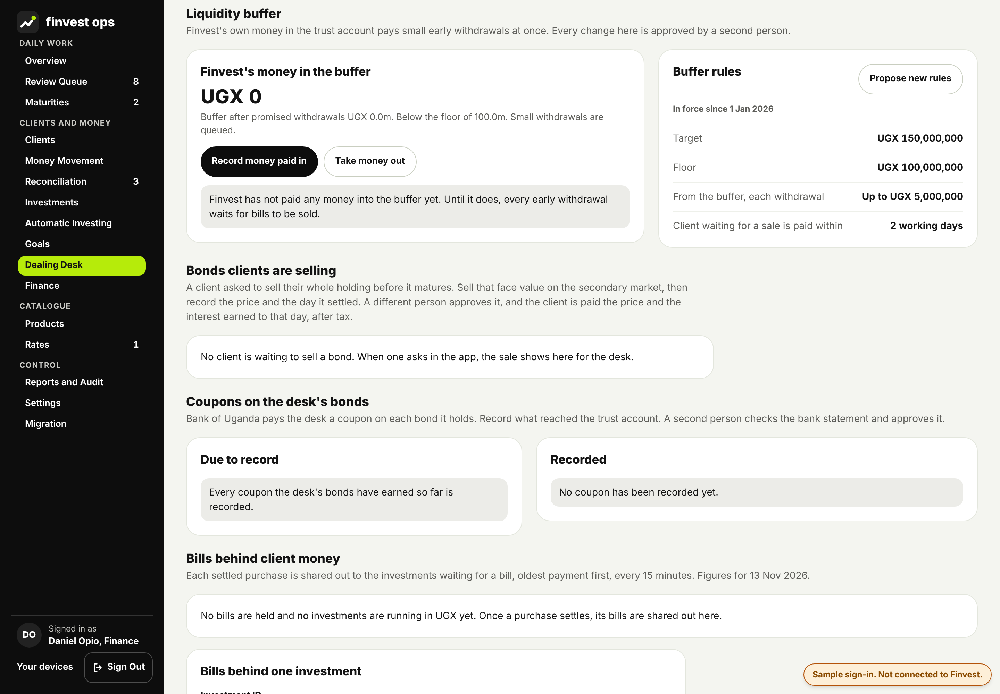

### Coupons could not be loaded (error) (wide)

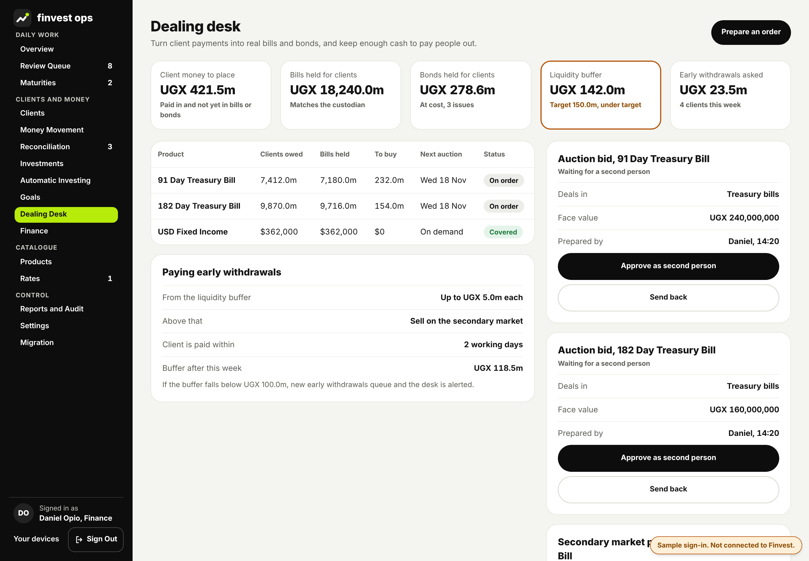

## Phone

### Coupons due and recorded (phone)

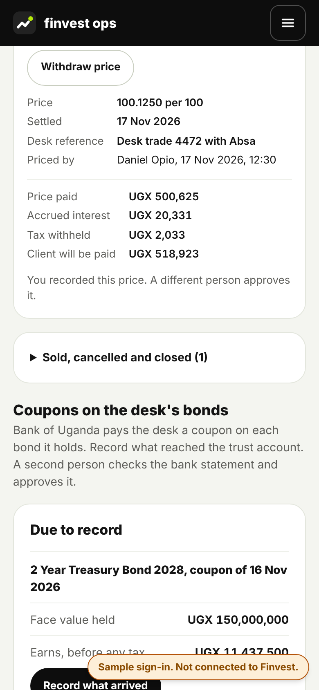

### Record a coupon (phone)

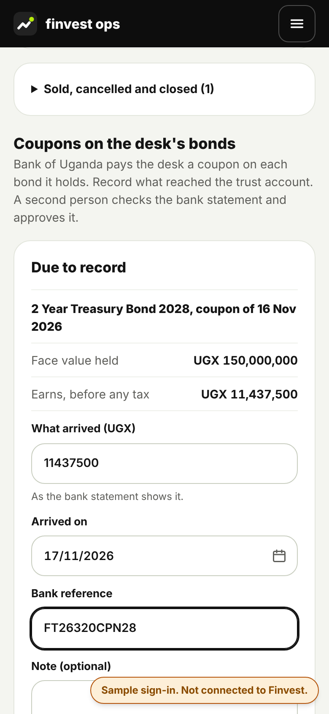

### Record a coupon that differs (needs a note) (phone)

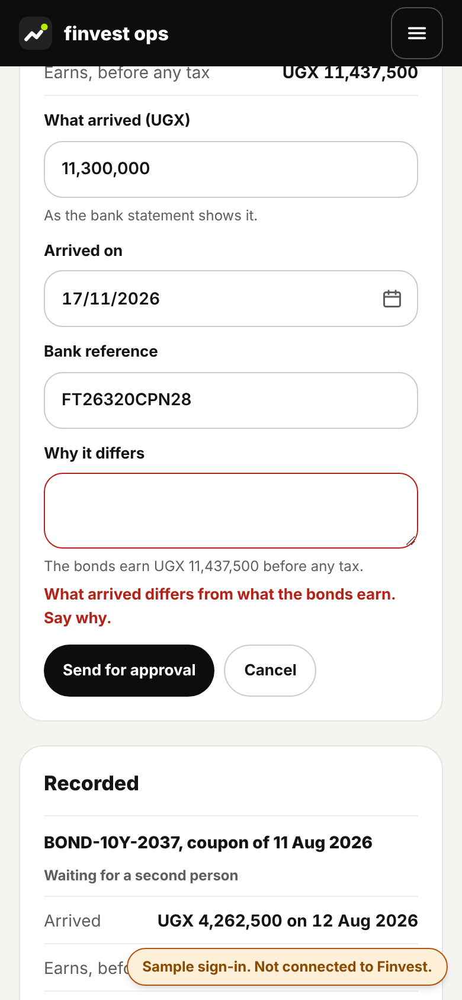

### Approve a coupon (bank statement question) (phone)

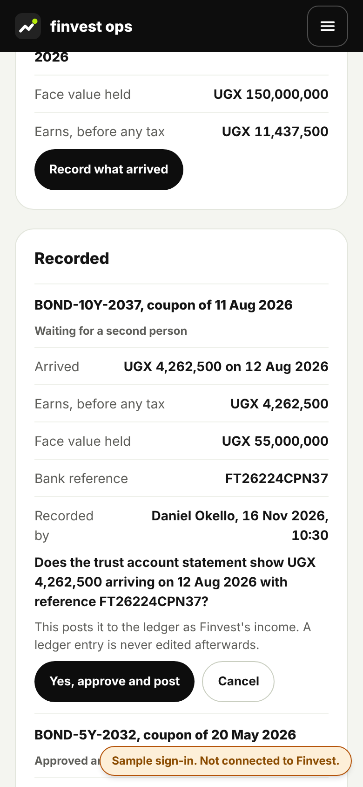

### Coupon approved and posted (phone)

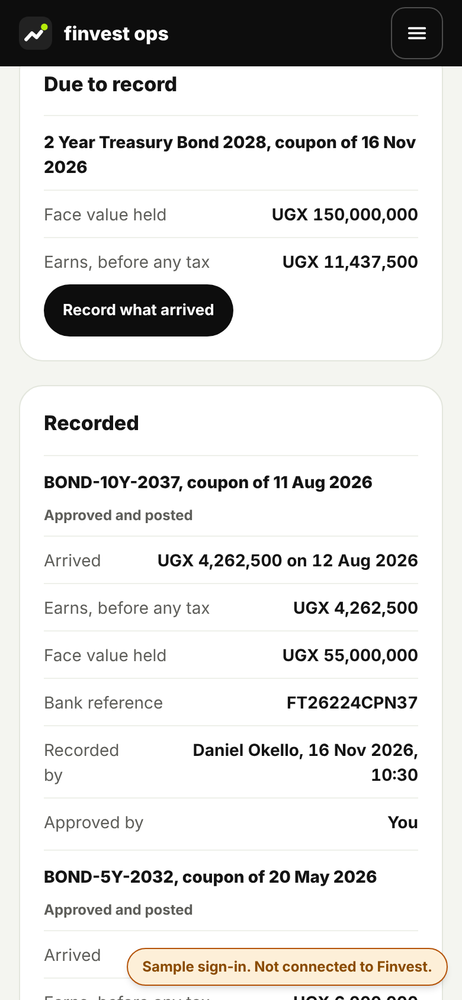

### Nothing due or recorded (empty) (phone)

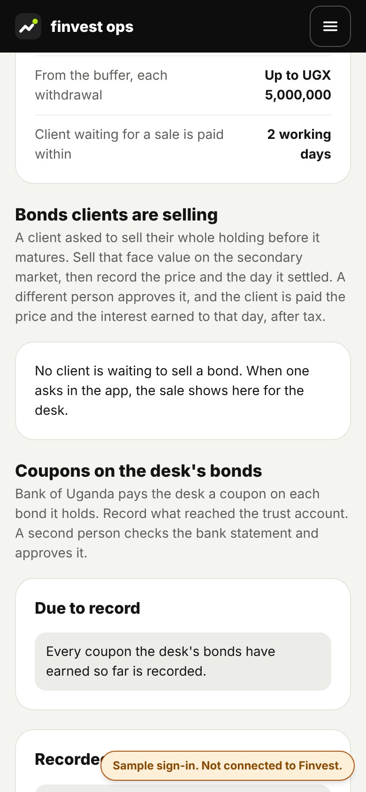

### Coupons could not be loaded (error) (phone)

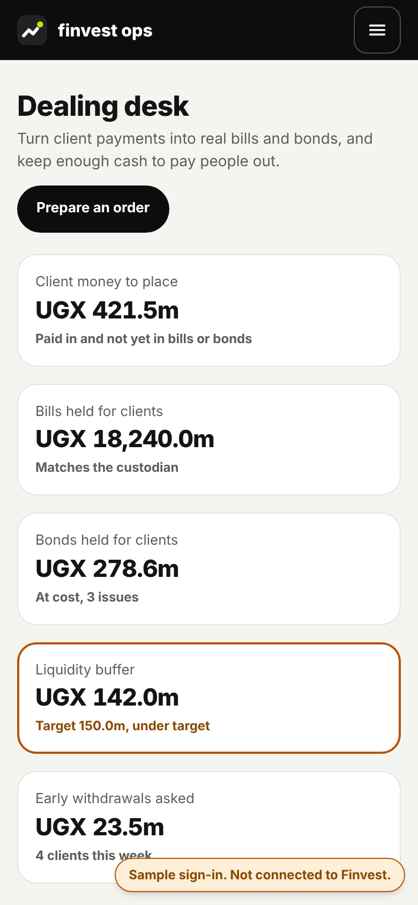
