# Bonds on the dealing desk

Console stub, signed in as Finance. `?sample=empty` shows the desk with no bond issues.

## Wide

### Dealing desk with bonds (wide)

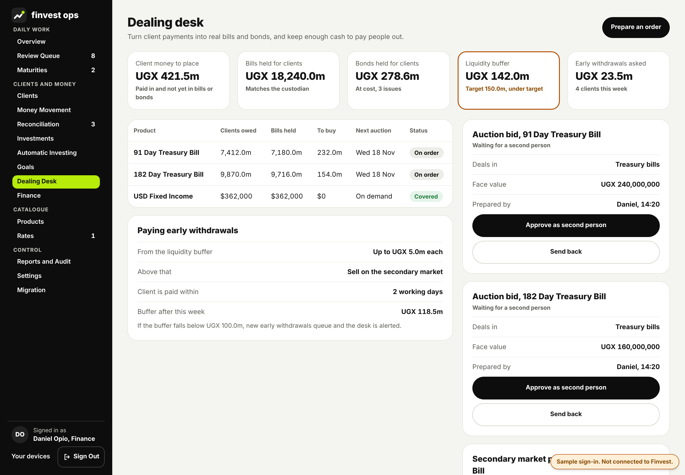

### Treasury bonds by issue (wide)

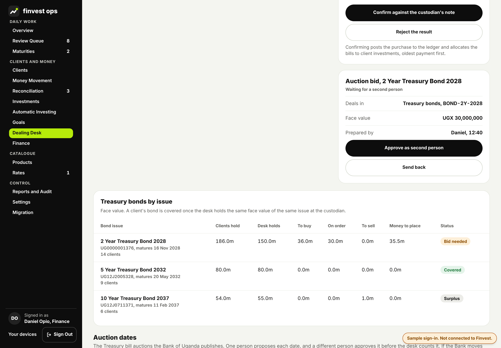

### Bond order card (deals in) (wide)

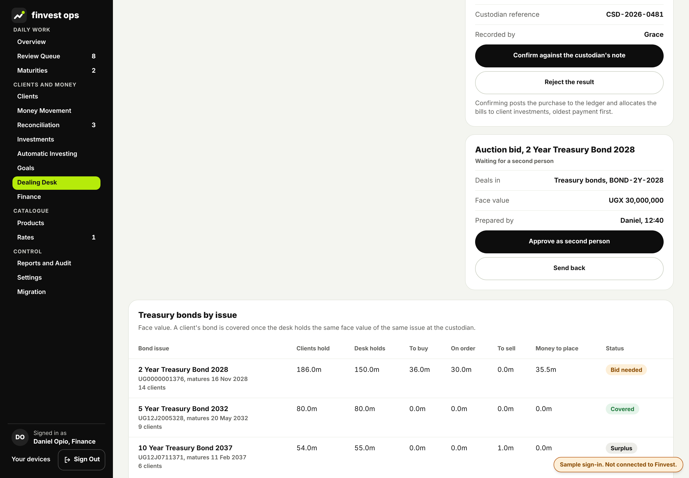

### Prepare a bond order (wide)

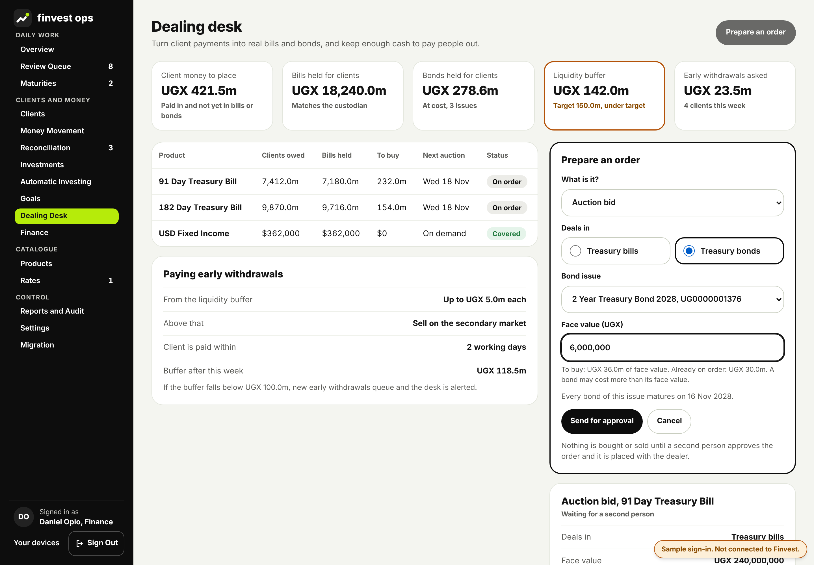

### Bond sale larger than the surplus (wide)

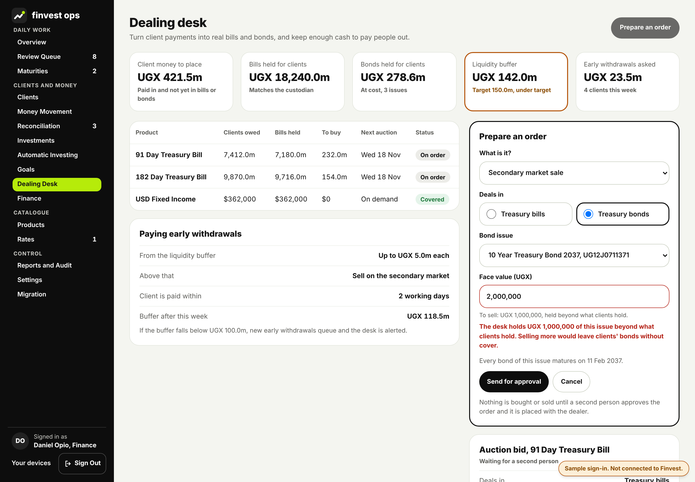

### Bond result, maturity filled from the issue (wide)

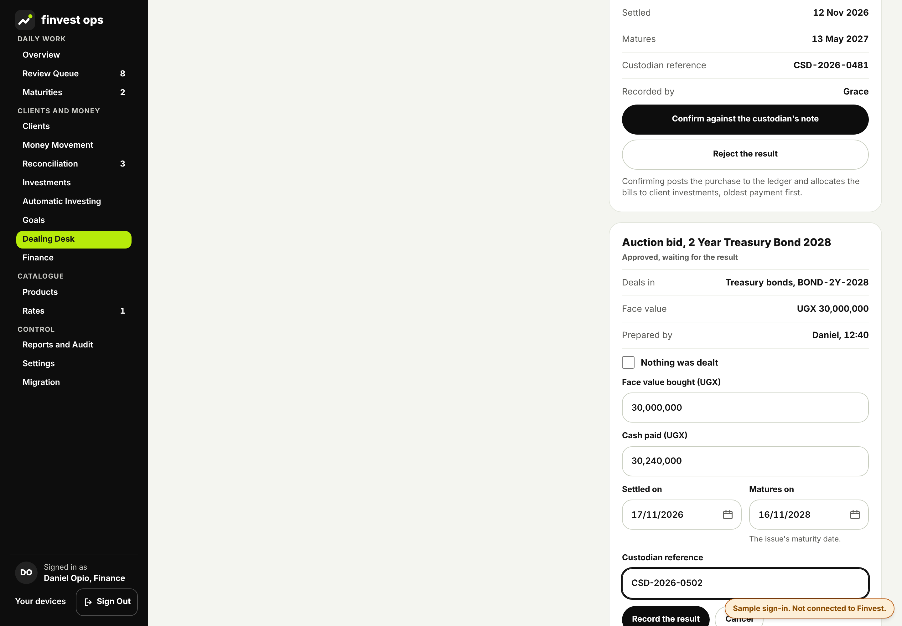

### Bond result with another maturity date (wide)

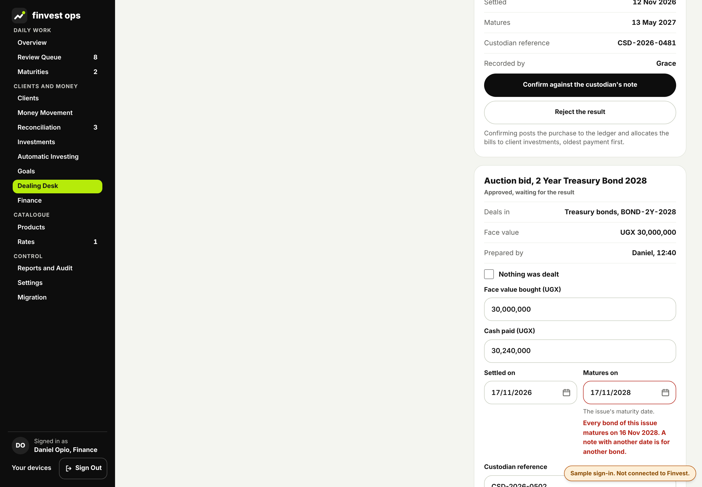

### No bond issues open (empty) (wide)

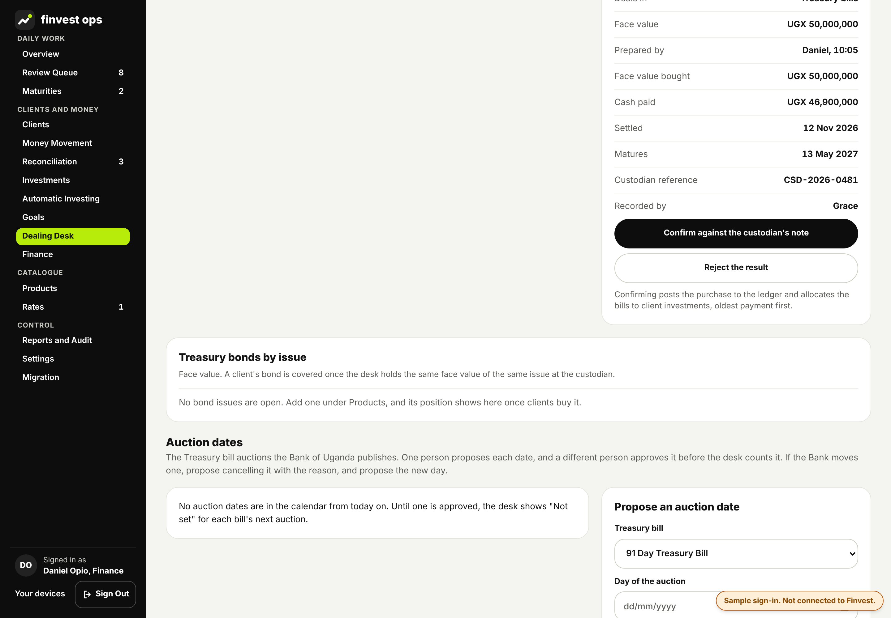

## Phone

### Dealing desk with bonds (phone)

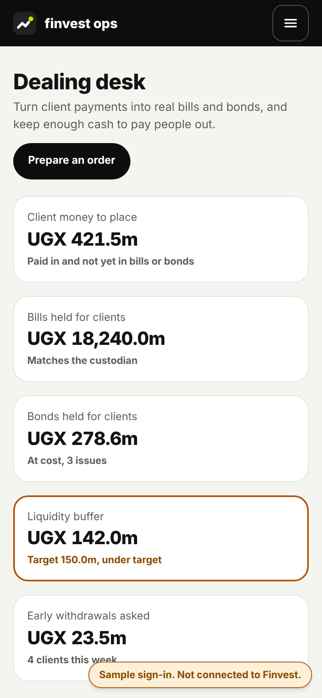

### Treasury bonds by issue (phone)

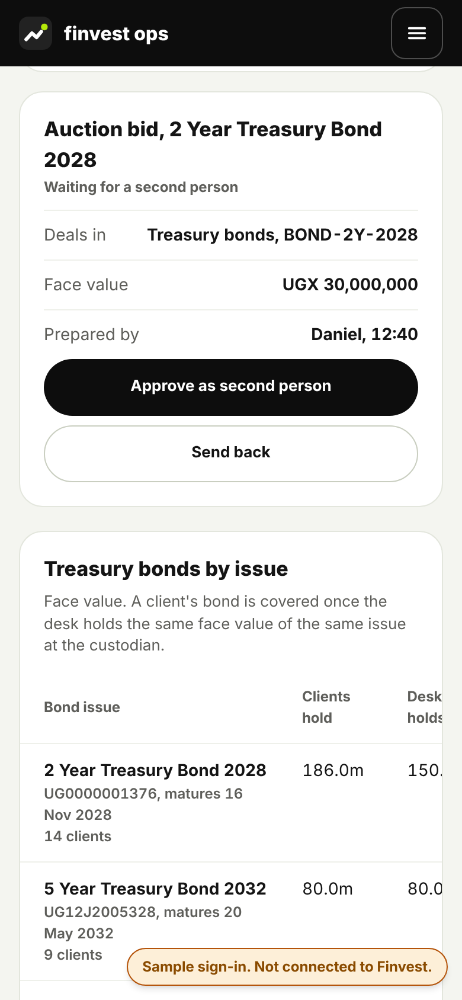

### Bond order card (deals in) (phone)

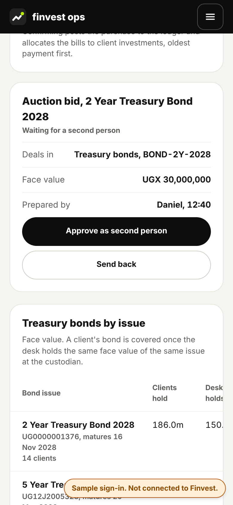

### Prepare a bond order (phone)

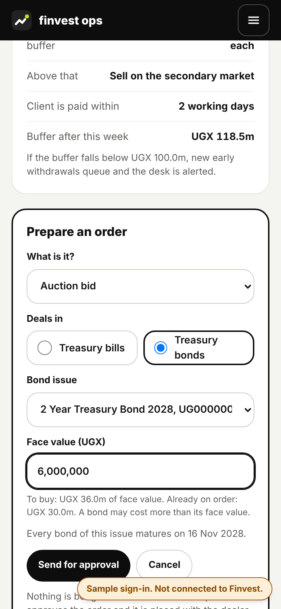

### Bond sale larger than the surplus (phone)

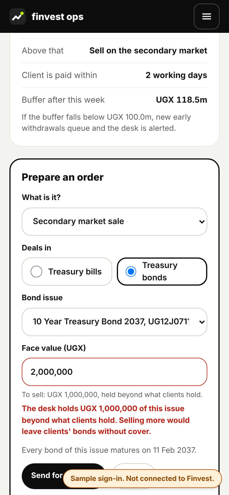

### Bond result, maturity filled from the issue (phone)

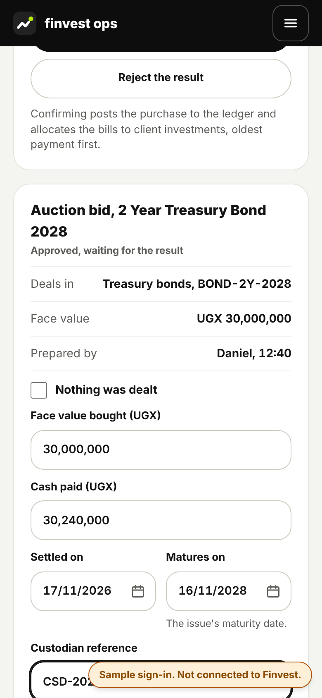

### Bond result with another maturity date (phone)

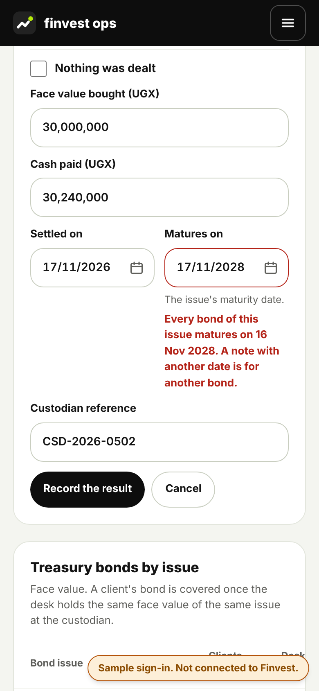

### No bond issues open (empty) (phone)

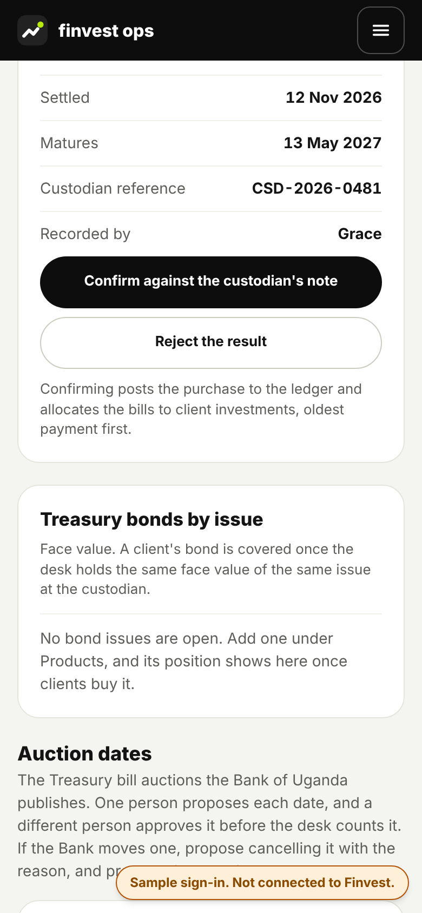
