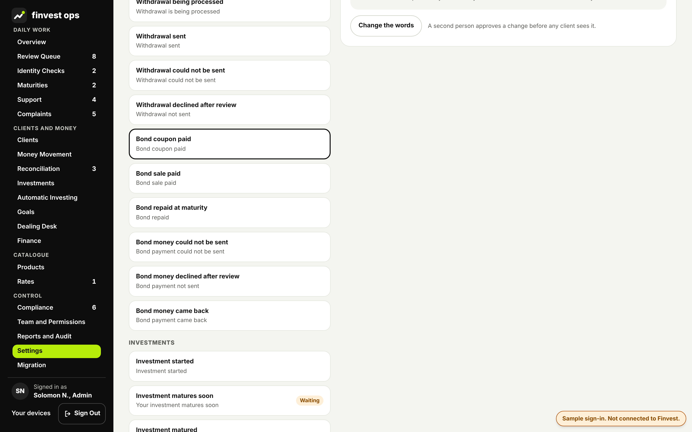
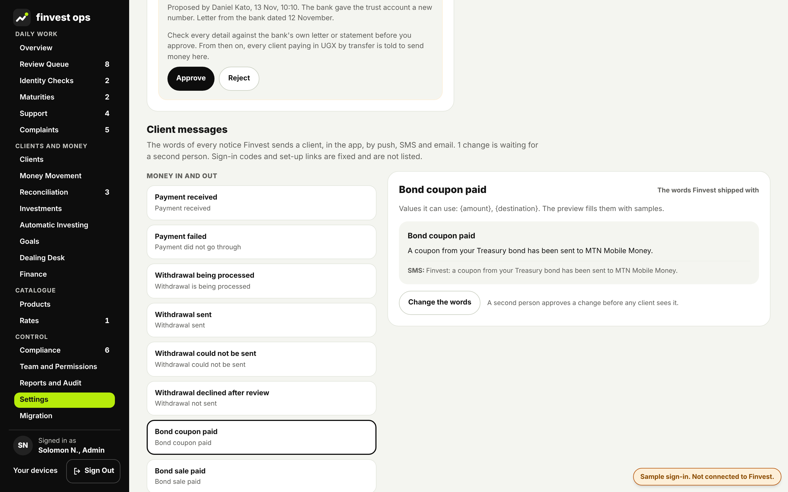
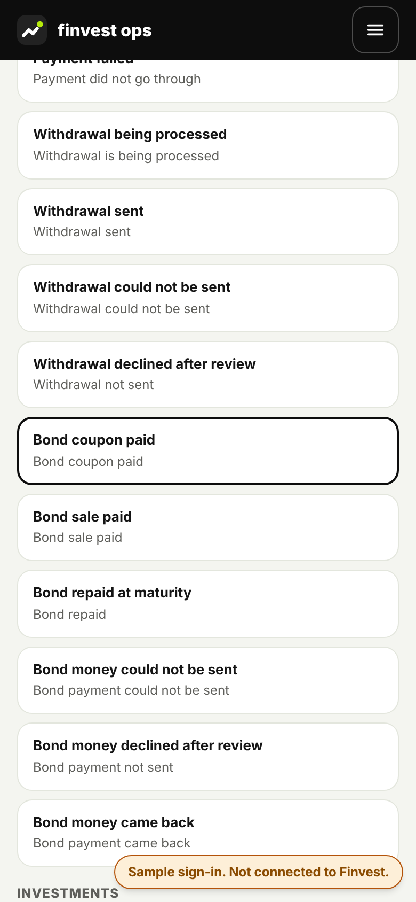

# Settings, Client messages: bond money

Console stub (`stub-admin`). Six new messages under "Money in and out": a bond coupon, sale and repayment paid, and bond money that could not be sent, was declined or came back.

## The list, wide

## The coupon's words, wide

## The list, phone

