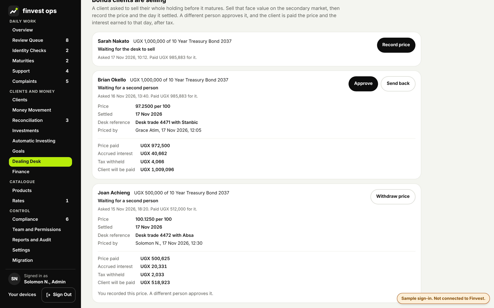
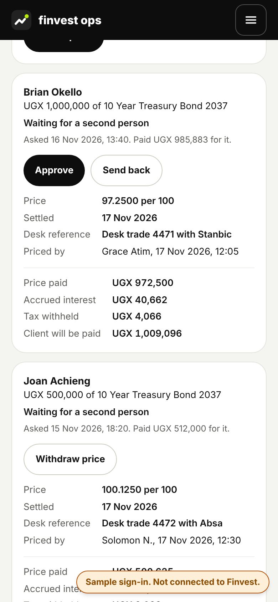

# Bond sale: what the client gets, shown to the approver

Console stub (`stub-admin`), Dealing Desk, "Bonds clients are selling". A priced sale now shows the price paid, accrued interest, tax withheld and "Client will be paid", as the backend worked them out.

## Wide

## Phone

