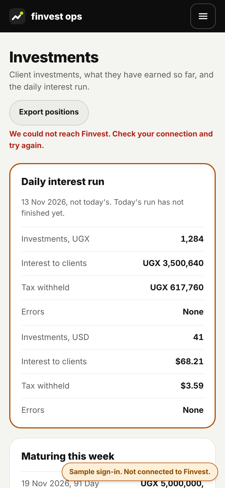
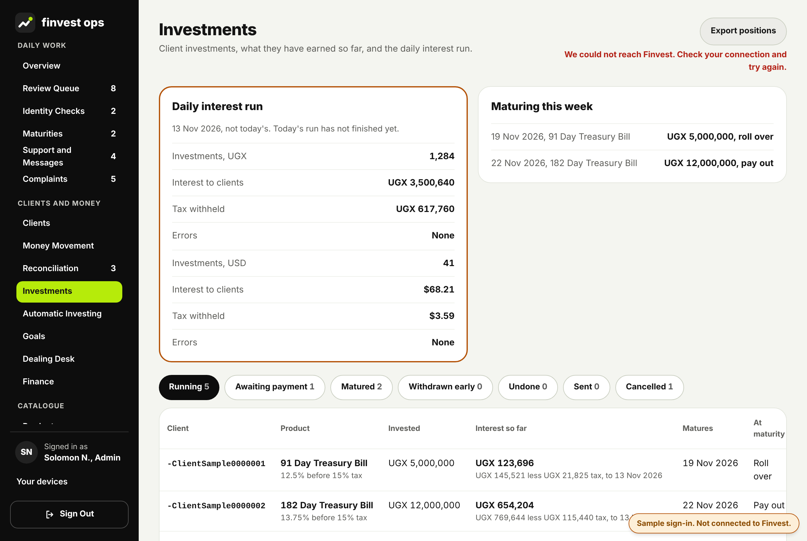

# Export positions on Investments

Console, sample data, phone (390 wide) and wide (1280 wide). The button downloads
`finvest-positions-<day>.csv`. If the export fails, the reason shows under the button in red. The failed shots were made by
taking away the sample export's file in the browser.

## Phone

### Default: under the heading when the header wraps

### The export failed

## Wide

### Default

### The export failed

