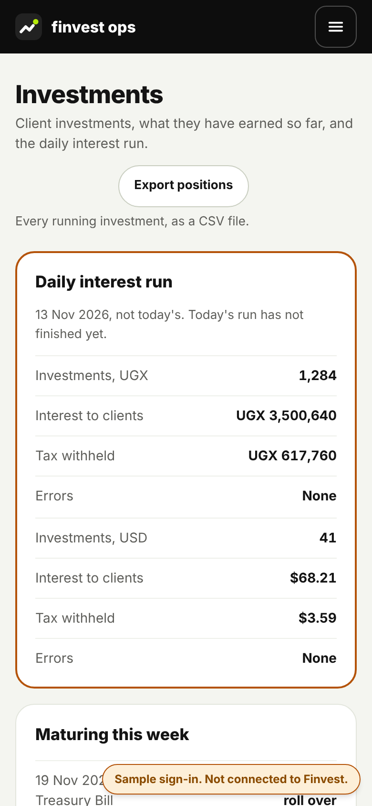
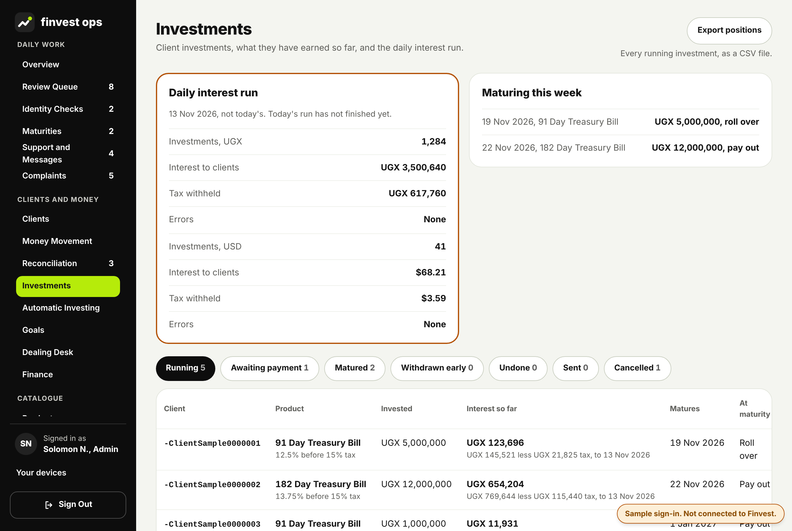

# Export positions on Investments

Console, sample data, phone (390 wide) and wide (1280 wide). The button downloads
`finvest-positions-<day>.csv`. If the export fails, the reason shows under the button in red
(covered by `src/screens/investments/index.test.tsx`).

## Phone

## Wide

