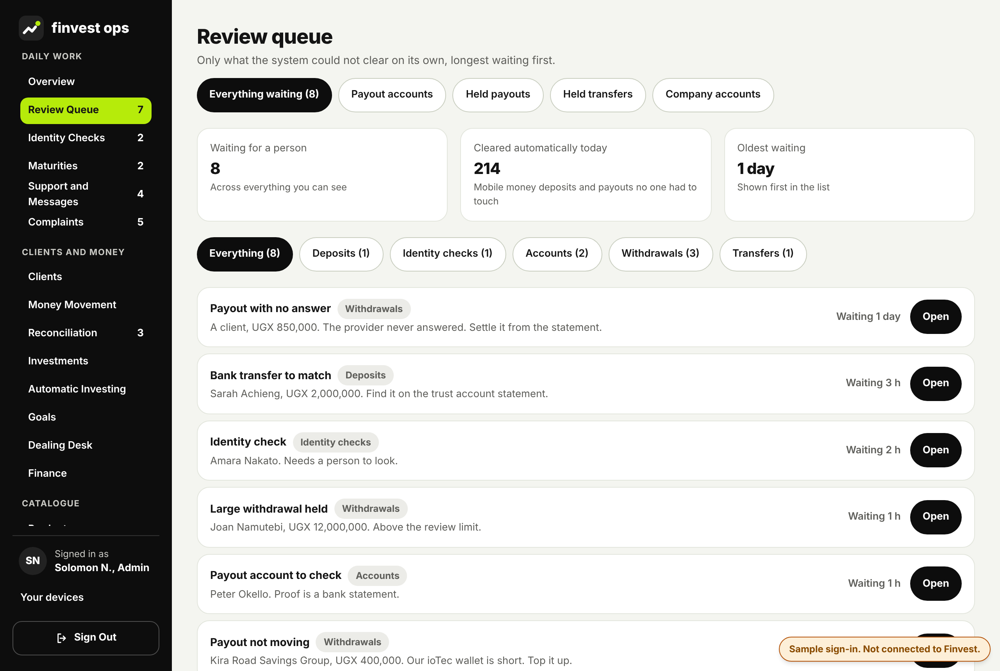
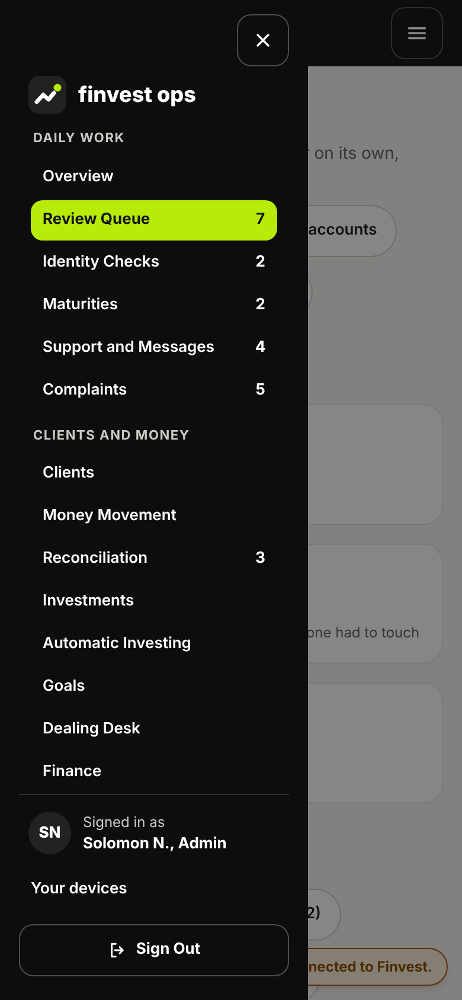
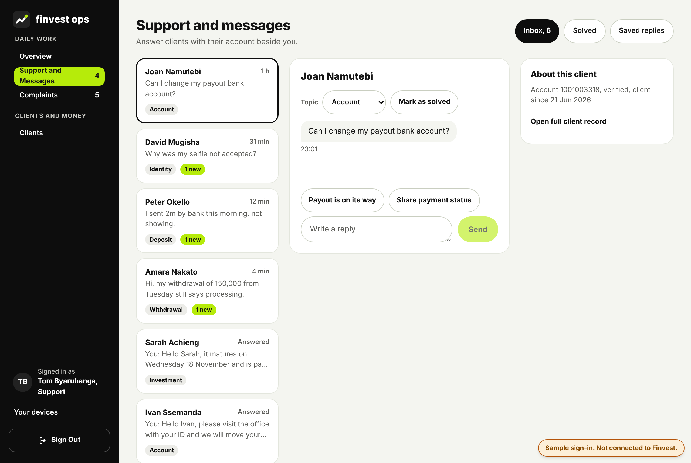
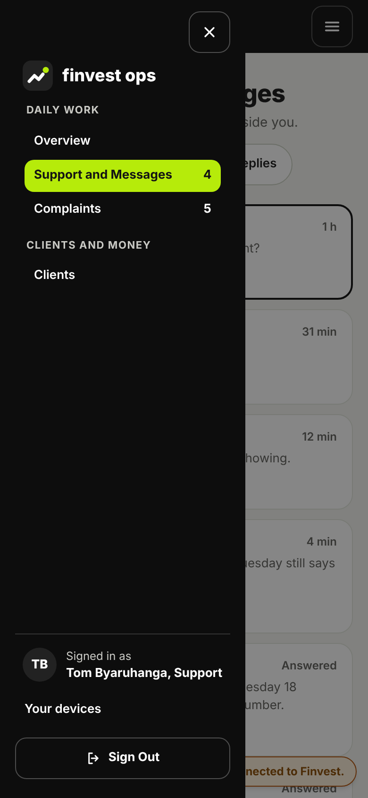

# Menu counts screenshots

From the console's sample build (`VITE_STUB_API=true`). The sample counts are the canvas's (AdminNav), so they do not match the sample lists on each screen. See docs/review-queue.md, "Counts on the menu".

## Admin: a count beside every screen that has work (wide)

## Admin: a count beside every screen that has work (phone)

## Support: counts only for the screens support can open (wide)

## Support: counts only for the screens support can open (phone)

