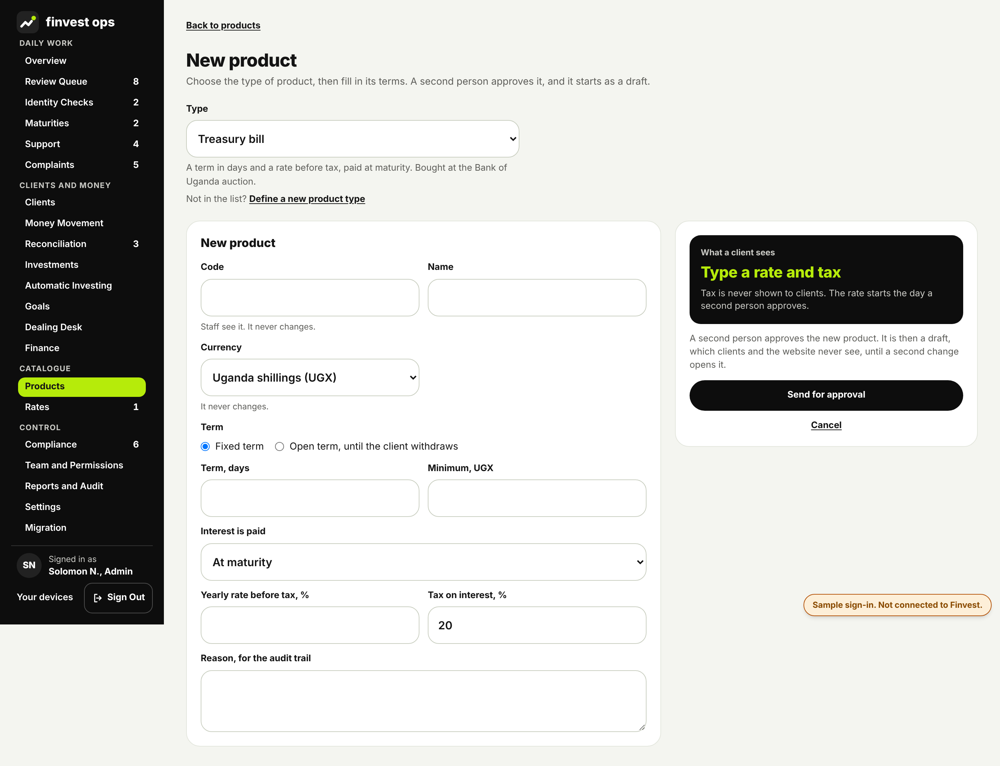
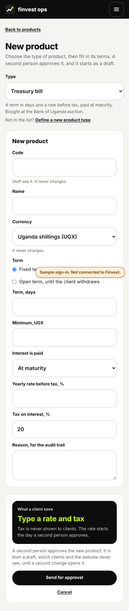
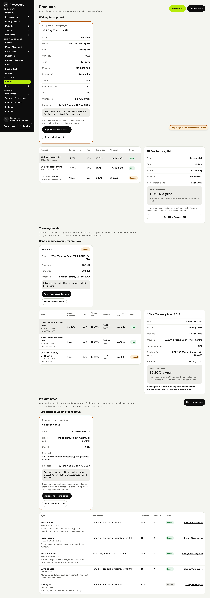

# Products: Type default and proposer names

Fixes items 7 and 8 of the product video bug list. Sample sign-in (stub data).

## New product, wide
Type starts on Treasury bill, with its usual tax of 20%.

## New product, phone

## Products with changes waiting, wide
Product, bond and type changes name the colleague who proposed them ("By Ruth Namata").

## Products with changes waiting, phone

