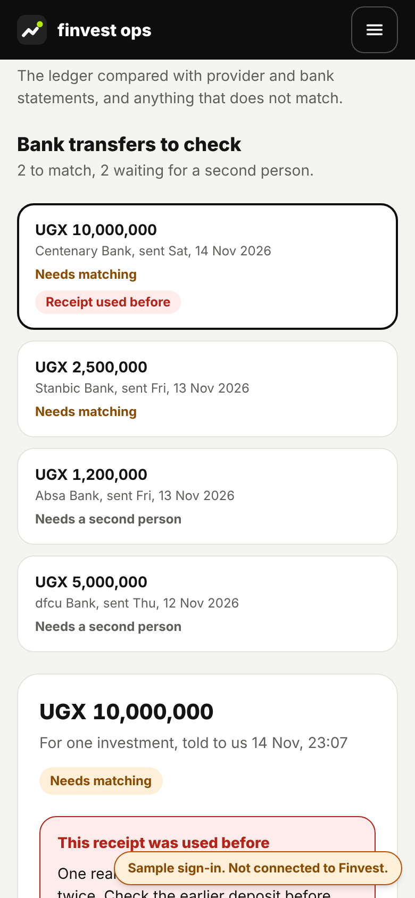
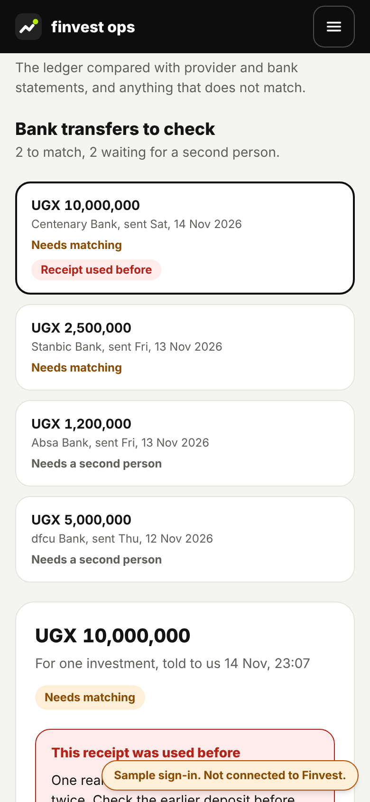
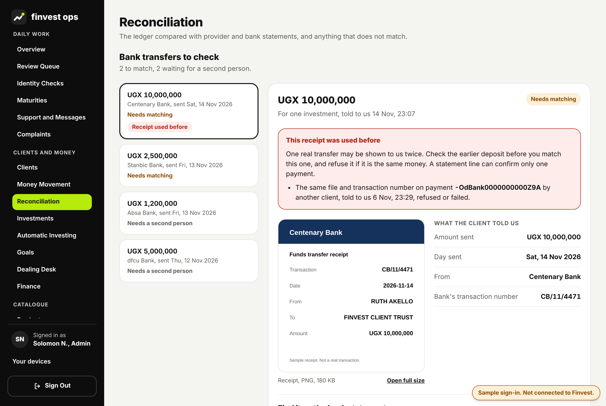
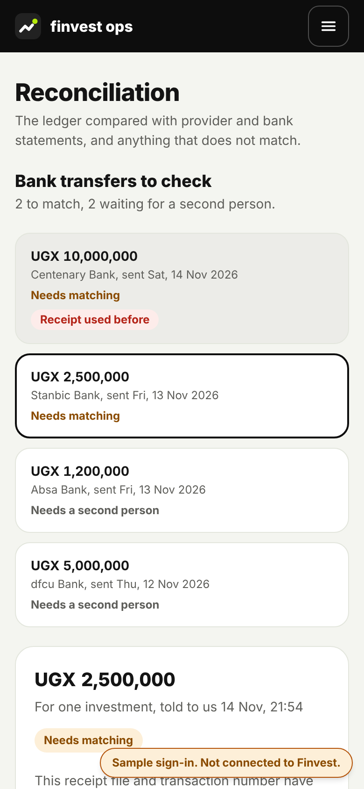
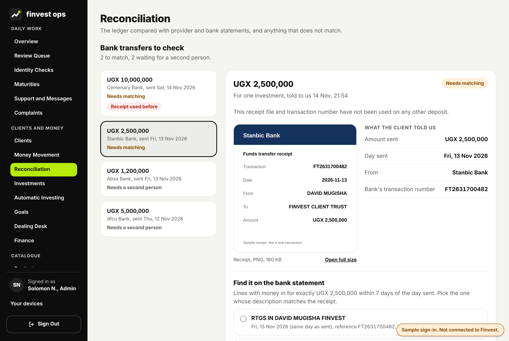

# Receipt used before screenshots

From the console's sample build (`VITE_STUB_API=true`). See docs/payments.md, "A receipt used before".

## A transfer whose receipt was handed in before (phone)

## A transfer whose receipt was handed in before (wide)

## The queue tags it (phone)

## The queue tags it (wide)

## A transfer whose receipt is new (phone)

## A transfer whose receipt is new (wide)

