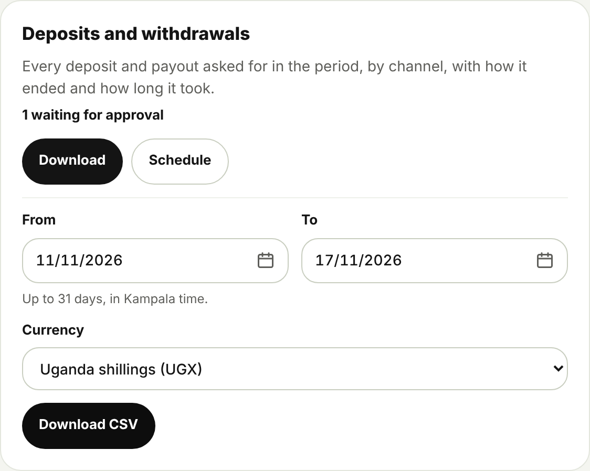
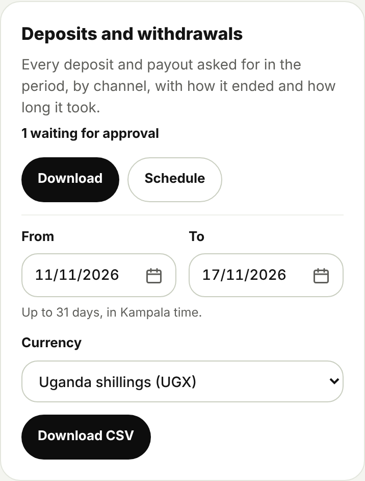
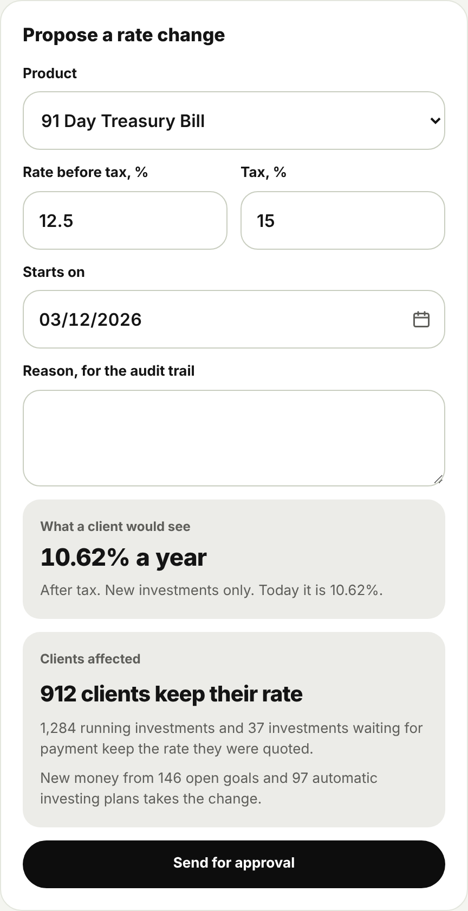
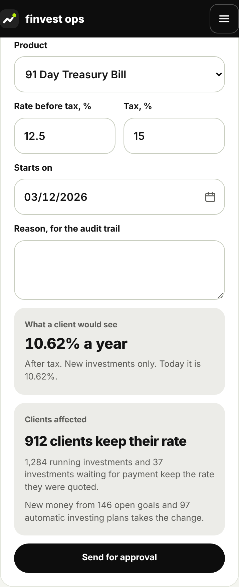
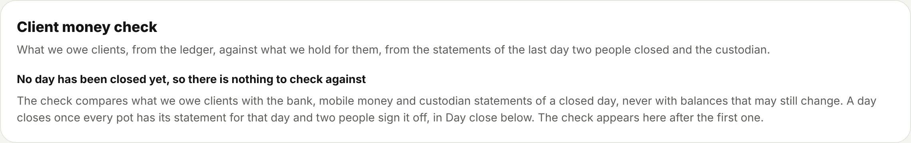
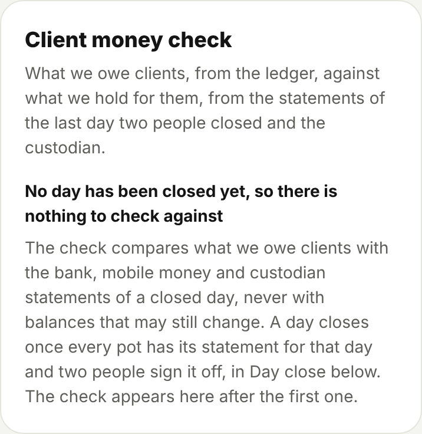
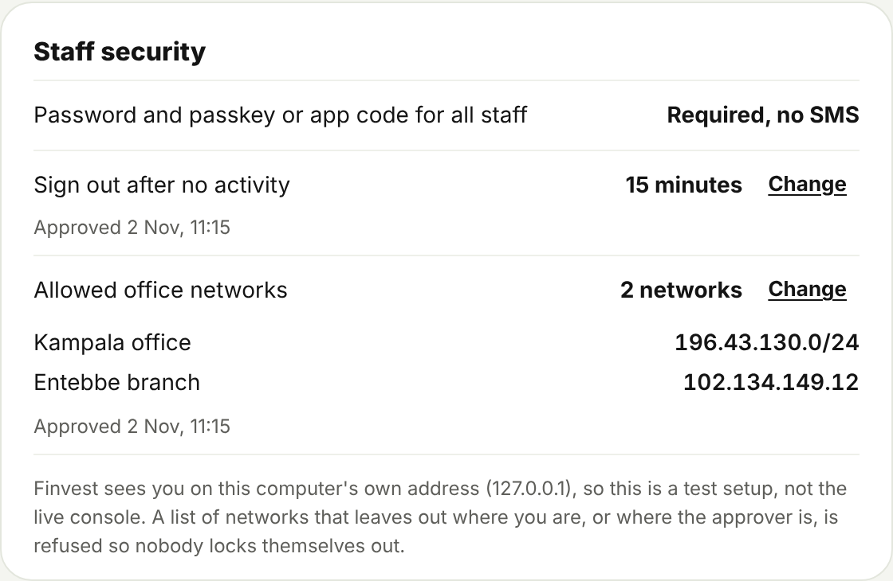
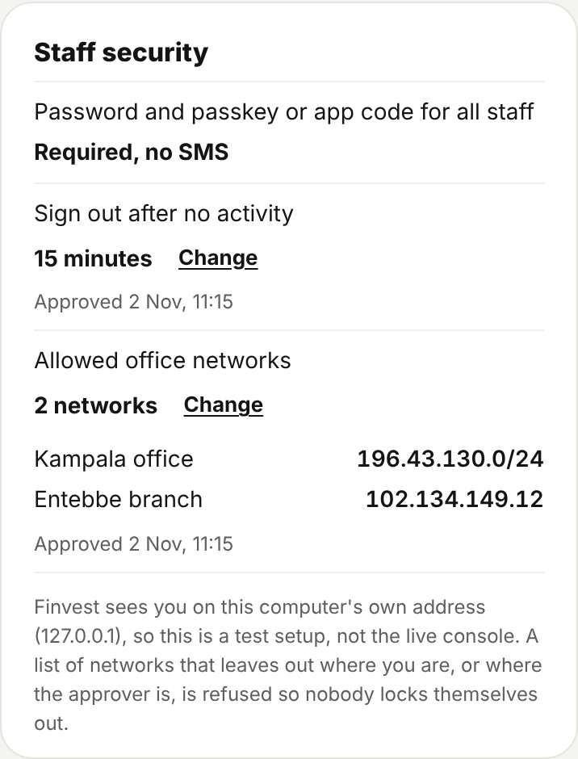
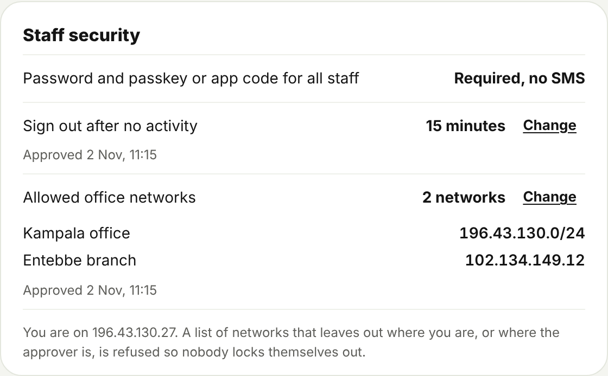
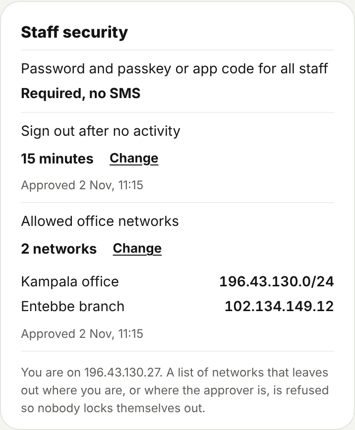

# Console fixes from the second product video (bugs 13, 14 and 16)

Taken from the console's sample data (`pnpm dev`), in a browser set to US English, which is where the old date fields showed mm/dd/yyyy.

## 16. Date fields read day first

Reports, Deposits and withdrawals, wide:

Reports, Deposits and withdrawals, phone:

Rates, "Starts on" after typing 3/12/2026 and leaving the field, wide:

Rates, "Starts on", phone:

## 13. Client money check before the first closed day

Reconciliation, wide:

Reconciliation, phone:

## 14. Settings, the address Finvest sees you on

On a test setup (`/settings?sample=local`), wide:

On a test setup, phone:

From an office network (unchanged), wide:

From an office network, phone:

