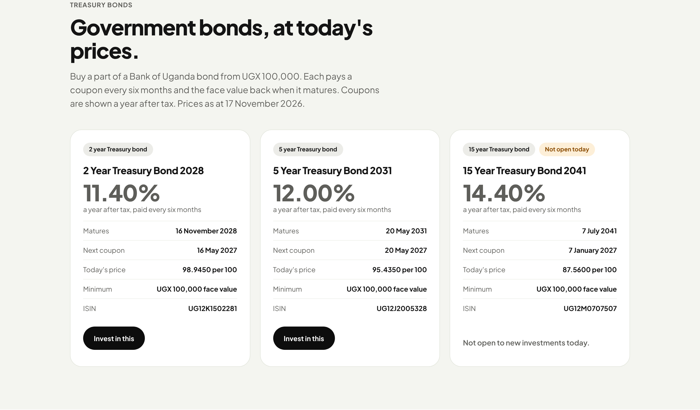
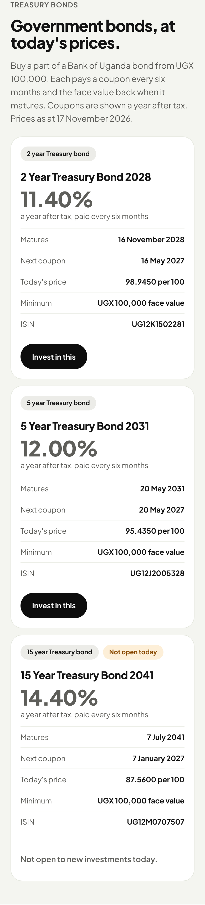
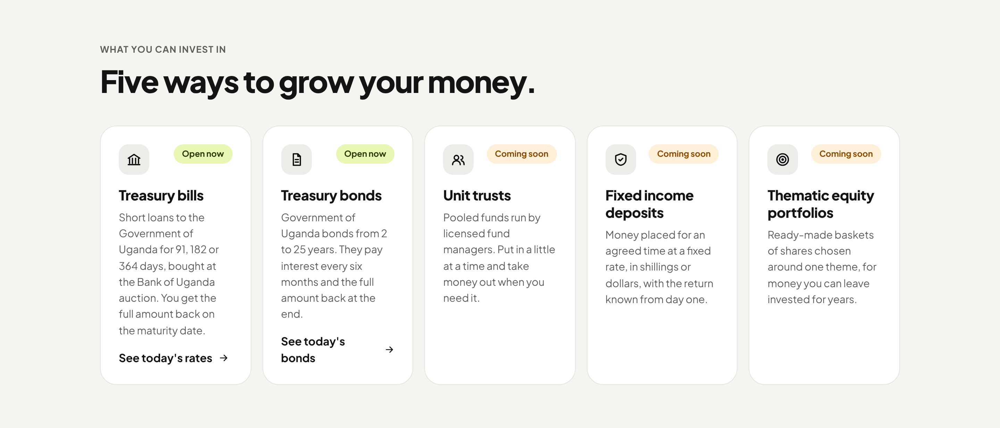
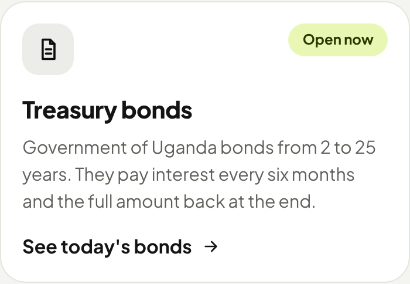
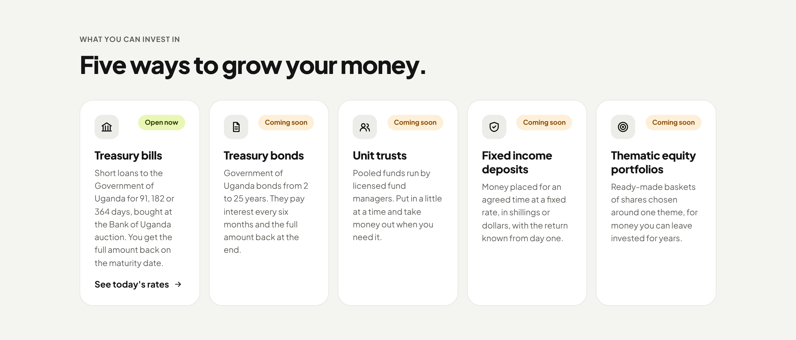
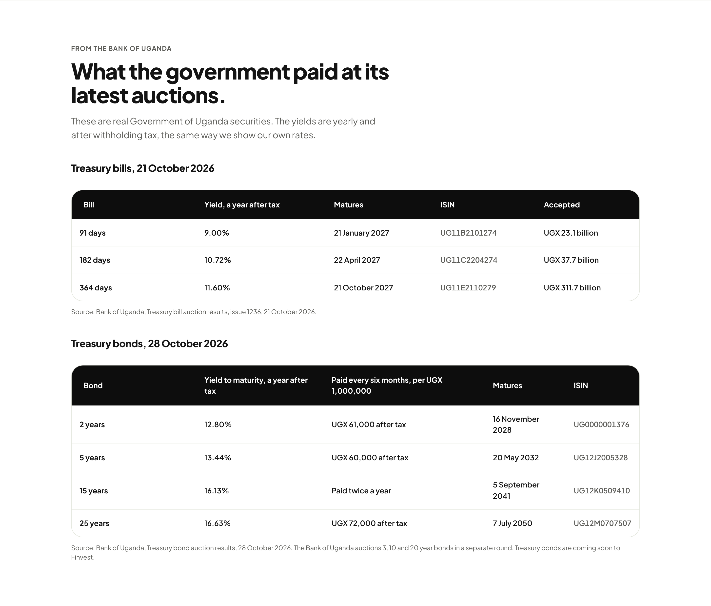

# Website: live Treasury bonds

Item 11 of the product video bug list. Served from a local build, with a stand-in API answering `GET /public/bonds` (sample issues, not real ones).

## Products, bonds section, wide

## Products, bonds section, phone

## Categories with a bond open, wide

## Treasury bonds category open, phone

## No bonds listed: category stays Coming soon, wide

## No bonds listed: auctions note still says coming soon, wide

