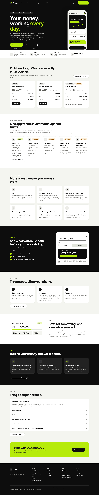
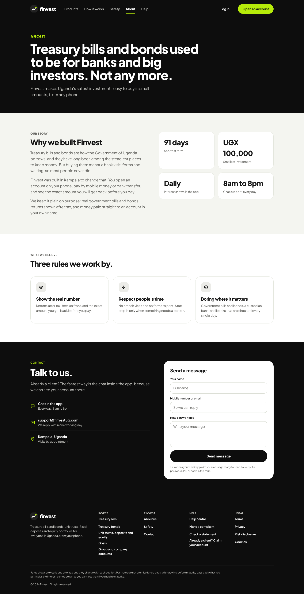
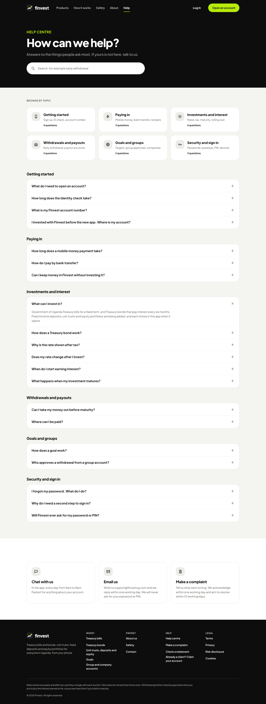
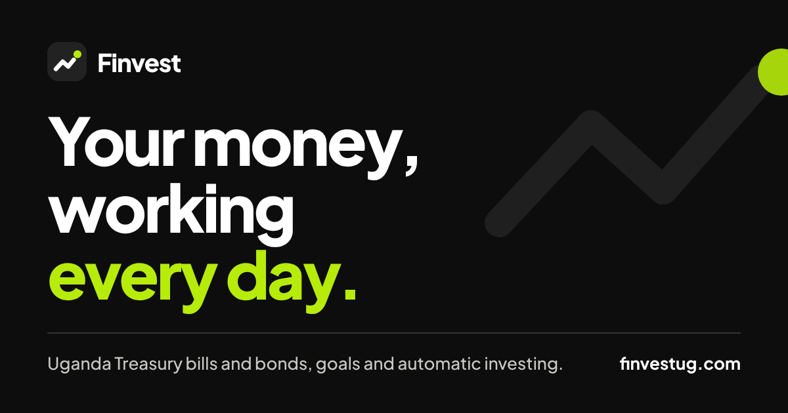
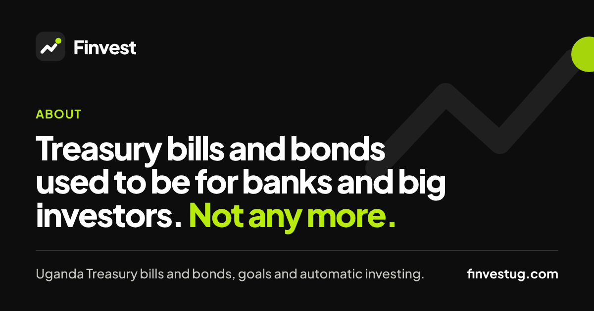

# Site covers everything Finvest does, and Uganda SEO

Built pages served by `pnpm preview`, with the API blocked, so the rates are the built-in ones and the Treasury bonds category shows its no-API state (it opens live when the API lists a bond issue).

## Home, wide

## Home, phone

## Products, wide

## About, wide

## Safety, wide

## Help centre, wide (Investments topic open, with the two new questions)

## Share picture, home (also the client app's)

## Share picture, about

