# Statement check screenshots

The website's check page (finvestug.com/check) from the built site, with the API's answers stood in by the screenshot script, and the statement PDF with its check code. See docs/documents.md, "Checking a statement".

## The check page (phone)

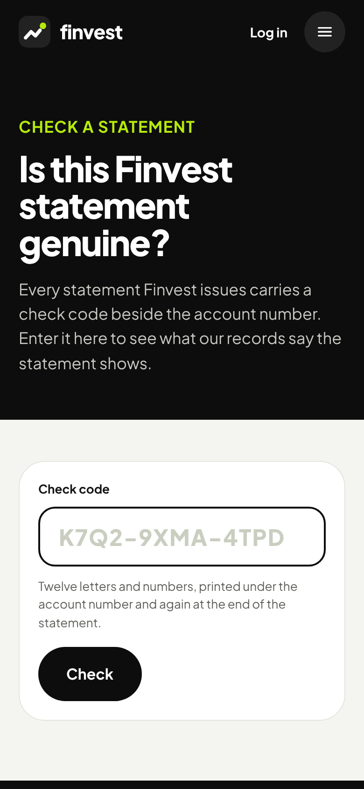

## The check page (wide)

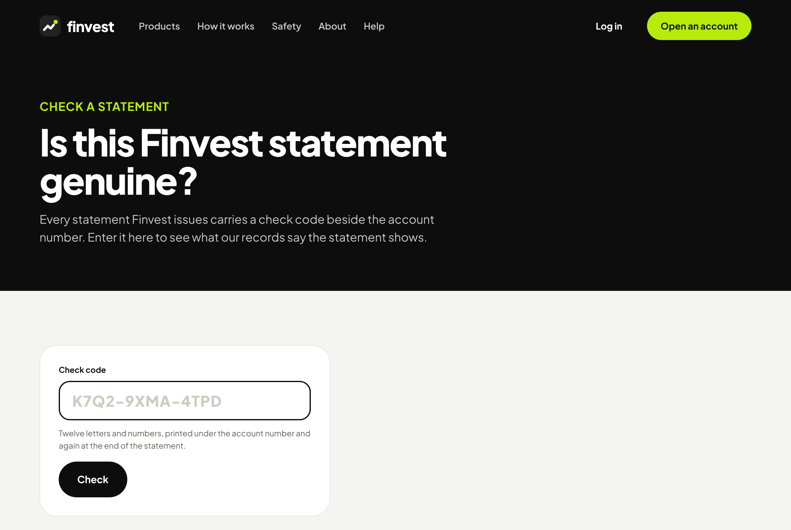

## A genuine statement (phone)

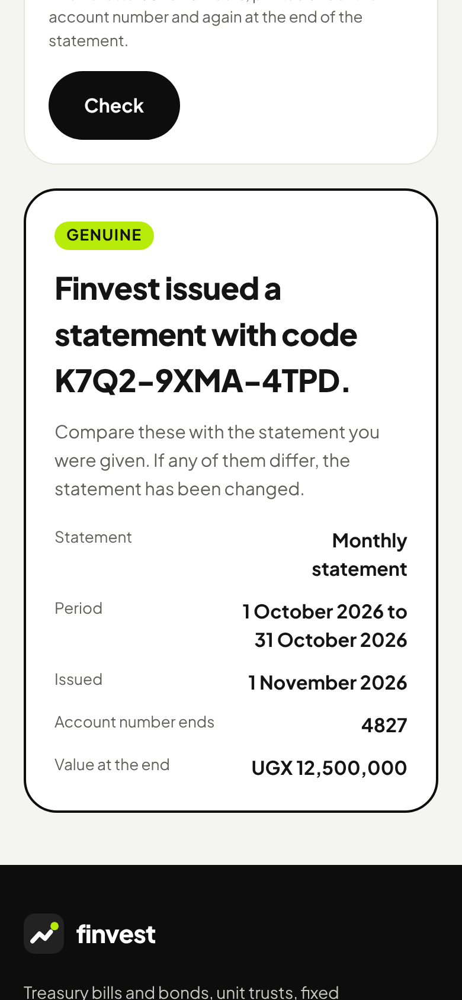

## A genuine statement (wide)

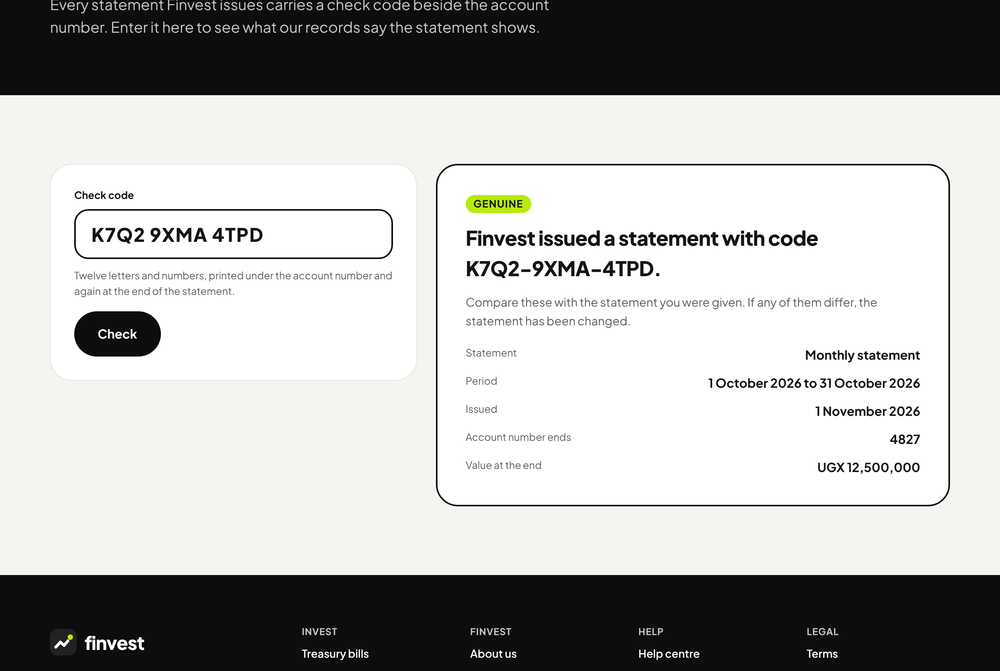

## A code no statement has (phone)

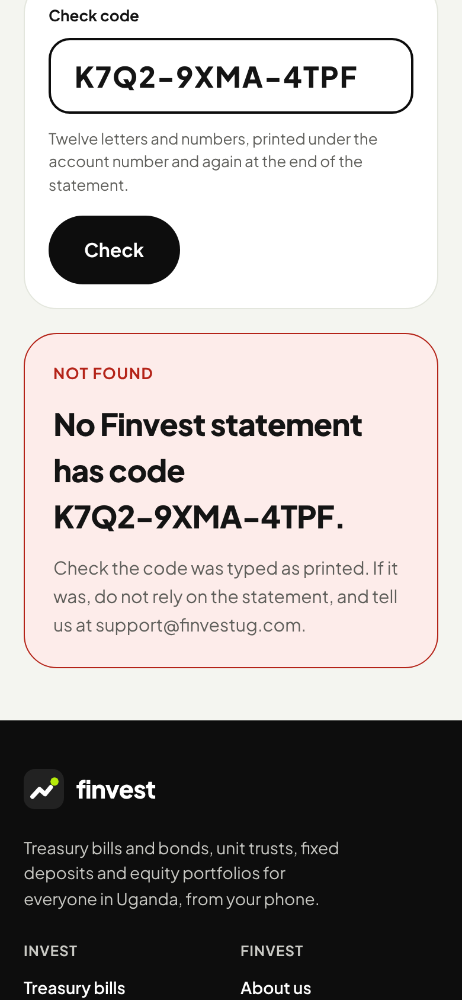

## A code no statement has (wide)

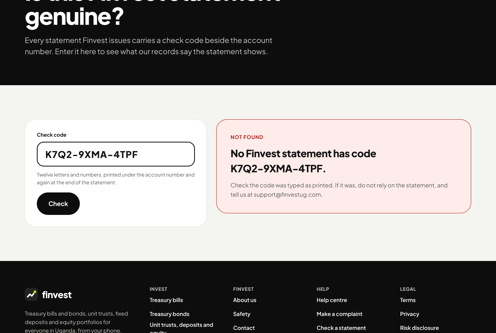

## A code typed wrong (phone)

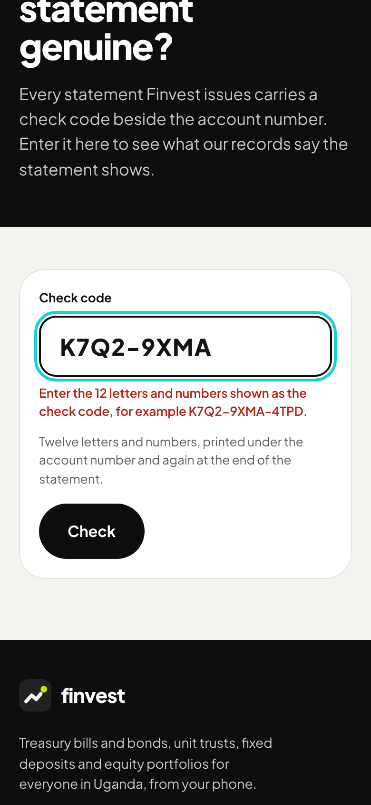

## A code typed wrong (wide)

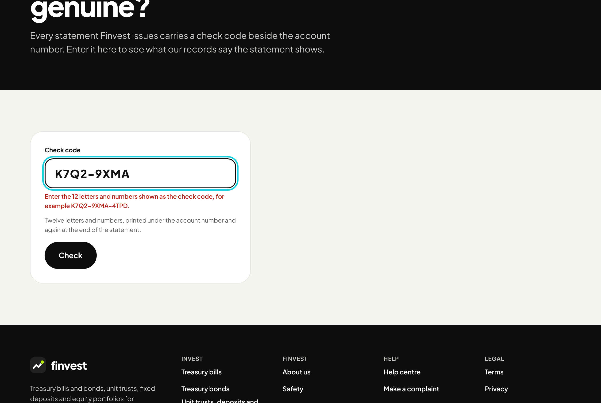

## The API could not be reached (phone)

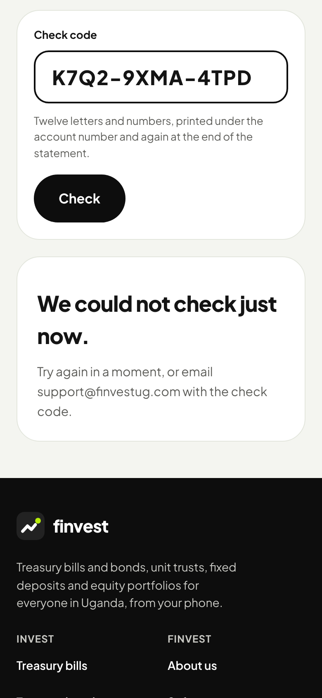

## The API could not be reached (wide)

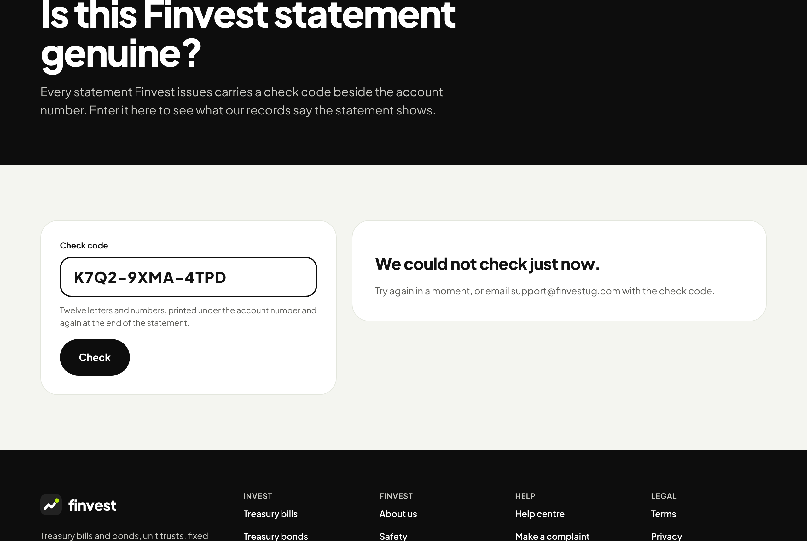

## The statement PDF with its check code

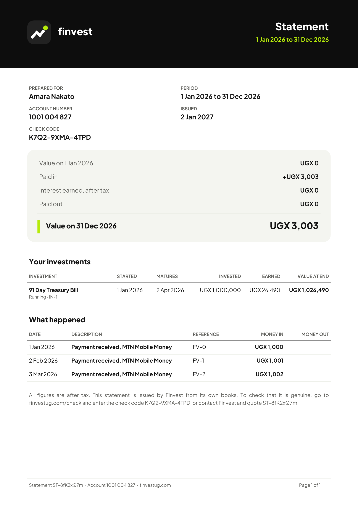
